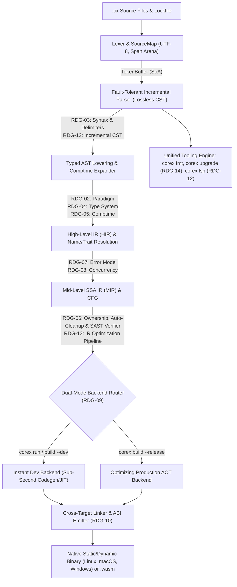

# Master Engineering Roadmap: CoreX (`0.0` → `0.0.1` Self-Hosted → `0.x` → `1.0` Stable)

> *Build reliable software effortlessly at systems-level speed.*

This document is the canonical engineering roadmap and architectural Single Source of Truth (SSOT) for taking **CoreX** (`corex-lang/corex`, `.cx`) from Phase 0 to its 100% self-hosted **`v0.0.1`** initial release (`Phase 12`), through **post-`v0.0.1` (`0.x`)** capabilities and real-world maturation (`Phase 13+`), and ultimately to a battle-tested **`v1.0.0`** first stable release.

---

## 1. Architectural Overview & Research Decision Gates (`RDG`)

To guarantee that no compiler subsystem prematurely hardcodes algorithms or syntax choices that belong to `Deep research`, the compiler is architected around strict **representation boundaries** and **20 Research Decision Gates (`RDG-01`–`RDG-20`)**. Each gate maps 1-to-1 to its prompt in [docs/research/PROMPTS.md](docs/research/PROMPTS.md) and its resolved specification report at `docs/research/DR-XX.md`.

| Gate ID      | Research Specification Report                      | Blocking Phase         | Modular Boundary / Interface Governed                                                                             |
| ------------ | -------------------------------------------------- | ---------------------- | ----------------------------------------------------------------------------------------------------------------- |
| **`RDG-01`** | [`docs/research/DR-01.md`](docs/research/DR-01.md) | Phase 0                | Bootstrap implementation language, build scripts, arena allocator primitives, self-hosting seed strategy          |
| **`RDG-02`** | [`docs/research/DR-02.md`](docs/research/DR-02.md) | Phase 2                | Programming paradigm, expression vs. statement semantics, mutability defaults, data composition model             |
| **`RDG-03`** | [`docs/research/DR-03.md`](docs/research/DR-03.md) | Phase 1 / 2            | Ergonomic syntax, `TokenKind` table, block/generic delimiters, grammar production rules, casing rules             |
| **`RDG-04`** | [`docs/research/DR-04.md`](docs/research/DR-04.md) | Phase 4                | `TypeArena`, bidirectional constraint solver, constrained type groups (`Number`), variance rules                  |
| **`RDG-05`** | [`docs/research/DR-05.md`](docs/research/DR-05.md) | Phase 5                | `MirInterpreter` / `comptime` evaluator, type-level evaluation, compile-time reflection hooks                     |
| **`RDG-06`** | [`docs/research/DR-06.md`](docs/research/DR-06.md) | Phase 6                | Zero-GC automatic scope cleanup, interprocedural escape/alias inference, manual allocators, `MIR` SAST engine     |
| **`RDG-07`** | [`docs/research/DR-07.md`](docs/research/DR-07.md) | Phase 4 / 6 / 7        | Zero-overhead error union representation, `swiftcc` + `swifterror` ABI lowering, exhaustiveness diagnostics       |
| **`RDG-08`** | [`docs/research/DR-08.md`](docs/research/DR-08.md) | Phase 8 / 11 / 13.1    | Structured concurrency, coroutine/task lowering, data-race verification, OS I/O completion reactor                |
| **`RDG-09`** | [`docs/research/DR-09.md`](docs/research/DR-09.md) | Phase 7 / 13.0         | `CodegenBackend` trait, `-ofmt=c` & `--release` LLVM AOT (`Phase 7`), self-hosted Tier C `--dev` (`Phase 13.0`)   |
| **`RDG-10`** | [`docs/research/DR-10.md`](docs/research/DR-10.md) | Phase 8 / 13.3         | Cross-compilation target descriptors, standalone static/dynamic linking, C FFI ABI marshaler, `wasm32` emitter    |
| **`RDG-11`** | [`docs/research/DR-11.md`](docs/research/DR-11.md) | Phase 9                | Zero-friction URL/registry imports, content-addressable store (`~/.corex/cache`), `corex.lock` schema             |
| **`RDG-12`** | [`docs/research/DR-12.md`](docs/research/DR-12.md) | Phase 2 / 3 / 10       | Fault-tolerant lossless CST, incremental query database (`CompilerDb`), early-cutoff invalidation, `corex lsp`    |
| **`RDG-13`** | [`docs/research/DR-13.md`](docs/research/DR-13.md) | Phase 5                | Desugared `HIR` nodes, basic-block SSA `MIR` with place projections, SROA/inlining/DCE/monomorphization           |
| **`RDG-14`** | [`docs/research/DR-14.md`](docs/research/DR-14.md) | Phase 3 / 10           | Canonical CST pretty-printer (`corex fmt`), zero-legacy automated spec migration engine (`corex upgrade`)         |
| **`RDG-15`** | [`docs/research/DR-15.md`](docs/research/DR-15.md) | Phase 11 / 13.1–13.4   | Bootstrap `.cx` `std` (`Phase 11`) and post-`v0.0.1` `HTTP/2`, `TLS 1.3`, `std::tui`, & `std::ui` (`Phase 13`)    |
| **`RDG-16`** | [`docs/research/DR-16.md`](docs/research/DR-16.md) | Phase 9 (Seam) / 13.2  | Dependency-conflict solution synthesis, security-aware ranking, and lossless `corex.toml` interactive/LSP fix     |
| **`RDG-17`** | [`docs/research/DR-17.md`](docs/research/DR-17.md) | Phase 6 / 9 / 10       | Zero-annotation `MIR` call-graph capability inference, supply-chain sandboxing, and `@no_alloc` / `@no_panic`     |
| **`RDG-18`** | [`docs/research/DR-18.md`](docs/research/DR-18.md) | Phase 7 / 8 / 11       | Deterministic `Context` simulation testing (`corex test --sim`) and native coverage fuzzing (`corex test --fuzz`) |
| **`RDG-19`** | [`docs/research/DR-19.md`](docs/research/DR-19.md) | Phase 7 (Seam) / 13    | Stateful live hot-code reloading (`corex run --watch`), `@must_vectorize` SIMD contracts, and VOPR cluster sim    |
| **`RDG-20`** | [`docs/research/DR-20.md`](docs/research/DR-20.md) | Phases 6–13            | Holistic superpower catalog (`D-01`–`D-11`), soundness/ABI fixes (`Prune-01`–`07`), and `195-LOC` seam map        |

---

## 2. Canonical Compiler Data Structures & Pipeline Interfaces

Regardless of the specific surface grammar (`RDG-03`) or backend (`RDG-09`) selected by research, the compiler's internal data structures are fixed around cache-friendly, arena-allocated Structure-of-Arrays (SoA) tables indexed by strongly typed 32-bit handles:

1.  **Compact Handle Primitives (`u32` Non-Exhaustive Enums with `0xFFFFFFFF` `none` Sentinel):**
    -   `FileId(u32)` – Indexes into `VfsSourceMap.files` (`DR-11` §2.4).
    -   `Span { file_id: FileId, start_byte: u32, end_byte: u32 }` – 12-byte (`extern struct`) exact byte range within `file_id`; line/column coordinates (`{ line: u32, col_utf8: u32, col_utf16: u32 }`) are resolved lazily via binary search over `LineIndex` (`line_starts: []const u32`) only when rendering diagnostics or LSP responses (`DR-01` §4.1, `DR-11` §2.4, `DR-12` §1.4 & §4.2).
    -   `SymbolId(u32)` (aliased as `StringId` in `DR-01`/`DR-04`/`DR-11`/`DR-12`) – Interned UTF-8 identifier/string handle via a shard-locked `StringInterner` backed by a contiguous `BumpArena` byte slab and an open-addressed hash table keyed by `Wyhash(0)` 64-bit hashes.
    -   `TokenId(u32)` (aliased as `TokenIndex` in `DR-01`/`DR-12`/`DR-14`), `CstNodeId(u32)` (aliased as `CstNodeIndex` in `DR-12`/`DR-14`), `AstNodeId(u32)` (aliased as `NodeIndex` in `DR-01`/`DR-04`/`DR-12`/`DR-13`), `HirId(u32)` (aliased as `HirIndex` in `DR-13`), `MirBlockId(u32)`, `MirValueId(u32)`, `TypeId(u32)`, `ScopeId(u32)`, `RegionId(u32)`, `DiagId(u32)`.
2.  **`SourceMap` & Virtual File System (`VfsSourceMap`):**
    -   Maps `FileId` to contiguous UTF-8 byte buffers (supporting memory-mapped disk files for CLI builds and in-memory overlay buffers for `corex lsp` and `corex fmt`).
    -   Precomputes `LineIndex` (`line_starts: Vec<u32>`) using SIMD newline scanning (`\n`, handling both `LF` and `CRLF`) during file load.
3.  **`TokenBuffer` (SoA Layout):**
    -   Stores parallel contiguous arrays: `kinds: Vec<TokenKind>`, `byte_offsets: Vec<u32>`, `byte_lengths: Vec<u16>`, `flags: Vec<TokenFlags>` (indicating preceding trivia/newline presence and lexical recovery status for the formatter and parser).
    -   Guarantees `O(1)` random token access and fits 64K tokens in `< 512 KB` of L2 cache.
4.  **`LosslessCstArena` & `AstArena`:**
    -   **Lossless Concrete Syntax Tree (CST):** Preserves 100% of source bytes – including comments, whitespace trivia, and malformed error recovery tokens – so `corex fmt`, `corex upgrade`, and `corex lsp` can round-trip any `.cx` file without losing a single byte.
    -   **Typed Abstract Syntax Tree (AST):** Compact, trivia-stripped view lowered from CST nodes into flat arena arrays for fast semantic analysis.
    -   Every syntax construct includes dedicated hole/error variants (`invalid_parse_subtree`, `item_hole`, `stmt_hole`, `expr_hole`, `type_hole`, `pattern_hole`) so syntax errors in one statement never abort type checking or LSP completion in adjacent functions.
5.  **`DiagnosticSink`, Canonical Code Prefix Registry & Monochrome Terminal Renderer:**
    -   Every diagnostic (`Diagnostic`) carries:
        -   `code: DiagnosticCode` – Strongly typed code governed by a non-overlapping prefix registry across all compiler subsystems:
            *   `E00xx` / `W00xx`: CLI, Workspace, Manifest (`corex.toml`), Lockfile (`corex.lock`), and VFS I/O (`DR-11`, `DR-16` `E0010`–`E0012`).
            *   `E01xx` / `W01xx`: Lexical Scanning, UTF-8 Validation, and Literal Diagnostics (`DR-03`, `DR-12`).
            *   `E02xx` / `W02xx`: Syntax Parsing, Delimiter Recovery, and Lexical Casing Diagnostics (`DR-03`, `DR-12`, `DR-14`).
            *   `E03xx` / `W03xx`: MIR SAST Memory, Exclusivity, Region Escape, Bounds, Concurrency, FFI, Capabilities, Contracts, and `--sim` Determinism Diagnostics (`DR-06` `E0301`–`E0307`/`W0308`/`E0313`/`W0314`, `DR-08` `E0309`, `DR-10` `E0308`/`E0310`–`E0312`, `DR-20`/`DR-17` `E0315`–`W0330`, `DR-18` `E0331`/`W0332`).
            *   `E04xx` / `W04xx`: Type System, Bidirectional Inference, Trait Conformance, Generic Constraint, and Error Exhaustiveness Diagnostics (`DR-04` §3.1 `E0400`–`E0415`, `DR-07`).
            *   `E05xx` / `W05xx`: `comptime` Virtual Machine (`MirVm`), Step-Limit/Fuel, MIR Lowering, and `@must_vectorize` Loop Contract Diagnostics (`DR-05`, `DR-13`, `DR-19` `E0520`–`E0522`).
        -   `severity: Severity` (`Error`, `Warning`, `Note`, `Help`),
        -   `primary_span: Span`,
        -   `secondary_labels: []const LabeledSpan` (arena-allocated slice of secondary spans with explanatory messages),
        -   `suggestions: []const SuggestedFix` (machine-applicable `TextEdit` byte replacements with `FixApplicability` per `DR-14` §2.5 for `corex fix`, `corex upgrade`, and LSP quick-fixes).
    -   `DiagnosticSink` enforces an explicit upper bound on emitted errors (`max_errors: u32 = 100`) per `AGENTS.md` Section 2 before halting emission with a summary note.
    -   Renders exclusively through the centralized terminal renderer (`.agents/skills/docs/SKILL.md` §4 and `DR-15.md` §2.1.2) using ANSI escape sequences and monochrome Unicode box-drawing characters (`╭`, `│`, `╰`, `├`, `─`, `▸`, `•`, `✓`, `✗`, `⚠`), respecting `NO_COLOR`, `--color=always|auto|never`, and terminal width detection.
6.  **Canonical Cross-Report Specification Invariants (`DR-01`–`DR-20`):**
    -   **Unified Binary Name:** The compiler and toolchain binary is always **`corex`** (`build/stage0/corex`, `build/stage1/corex`, `build/stage2/corex`).
    -   **Error Handling Model & ABI (`DR-03`, `DR-07`, `DR-20` `Fix-07` / `Prune-03`–`04`):** CoreX uses algebraic **`Result[T, E]`** and **`T?`** (`Option[T]`) with postfix **`expr?`** propagation, infix **`expr catch |err| { … }`**, and lexical **`defer` / `errdefer`** (superseding early `E!T` and prefix `try` notations). On unmodified LLVM 20–23 (`corex_llvm.cpp`), `cx_result_cc` lowers onto `swiftcc` + `swifterror` (`R12` on `x86_64`, `X21` on `AArch64`, `X19` on `Arm64EC`, plus 4 payload GPRs) with zero C++ LSDA personality bloat and mandatory minimal `.pdata`/`.xdata` frame unwind descriptors on Windows.
    -   **Parameter Modes & Surface Borrowing (`DR-02`, `DR-03`, `DR-06`, `DR-15`, `DR-20` `Fix-06B`):** Surface `.cx` syntax uses **`&T`** (shared immutable borrow, default for parameter passing), **`&mut T`** (exclusive mutable borrow), **`own T`** (consuming move transfer), and **`ref mut T`** (uninitialized out-parameter), lowering 1-to-1 into `HIR`/`MIR` parameter modes **`let`**, **`inout`**, **`sink`**, and **`set`**, with post-`yield` `subscript` writebacks lowered onto all normal and `?` exit edges (`DR-20` `Fix-06B`).
    -   **Square-Bracket Generics (`DR-03`):** Generic parameters and arguments always use square brackets **`[T]`** (`Vec[T]`, `Result[T, E]`, `SlotMap[K, V]`).
    -   **Unified `TokenKind` Table (`DR-03`, `DR-04`, `DR-05`, `DR-07`, `DR-12`):** Includes all base tokens from `DR-03` §5.2 plus `kw_comptime`, `kw_catch`, `kw_errdefer`, `kw_is`, `kw_bit_field`, `#soa` (`hash_soa`), wrapping operators `+%`, `-%`, `*%`, saturating operators `+|`, `-|`, `*|`, and underlying-type approximation `~`.
    -   **`DR-20` Pre-`v0.0.1` Soundness & Scope Amendments (`Prune-01`–`07`, `Reject-01`):** Whenever an earlier `DR-01`–`DR-19` baseline conflicts with [`docs/research/DR-20.md`](docs/research/DR-20.md) (`Bucket A`, `Bucket B`, `Bucket C`, and the `195-LOC` Seam Reservation Checklist), **`DR-20.md` takes precedence** – specifically demand-sliced Pentagon `Sub` (`MAX_SUB_VARS = 256`), `UnlinkAndReplace` Mach-O emission on macOS, target-ABI byte-array C bitfields, zero `libclang` C++ embedding, and building Tier C native codegen, `DR-16` MaxSAT, `HTTP/2` + `TLS 1.3`, `std::tui`, and `std::ui` **1x in `.cx`** across `Phase 13.0`–`13.4` after `v0.0.1` self-hosting.

---

## 3. Step-by-Step Engineering Phases (`Phase 0` → `Phase 12` `v0.0.1` Self-Hosted + `Phase 13` Post-`v0.0.1`)

### Phase 0: Bootstrap Foundation, Terminal Renderer & Verification Harness

-   **Prerequisite Gate:** **`RDG-01`** ([`docs/research/DR-01.md`](docs/research/DR-01.md) – Bootstrap Implementation Language & Build System).
-   **Deliverables:**
    1.  Initialize the Stage 0 compiler workspace in the chosen bootstrap systems language with maximum static analysis and `-Werror` enforcement.
    2.  Implement core foundational arenas: `BumpArena`, `StringInterner`, `SourceMap`, `Vfs`, and `Span` line/column lookup.
    3.  Implement the centralized CLI & Diagnostic Rendering Engine (`cli::style`, `cli::box_draw`, `diag::renderer`):
        -   Monochrome Unicode glyph registry (`╭`, `│`, `╰`, `├`, `─`, `▸`, `•`, `✓`, `✗`, `⚠`).
        -   Multi-line and single-line source snippet renderer with Unicode underline carets and inline fix diff previews.
        -   CLI command router (`corex build`, `corex run`, `corex check`, `corex test`, `corex fmt`, `corex upgrade`, `corex lsp`, `corex bench`).
    4.  Implement the automated test runner (`tests/unit`, `tests/snapshots`, `tests/compile_fail`, `tests/run_pass`, `tests/fuzz`) and benchmark harness (`bench/`).
-   **Verification Gate:**
    -   100% unit test coverage on `BumpArena`, `StringInterner`, `SourceMap` (both `LF` and `CRLF` files, multi-byte UTF-8 boundaries), and golden snapshot tests for single-span, multi-span, and cross-file diagnostic rendering.
    -   Drift guard test confirming zero colored emojis exist anywhere in the repository.

### Phase 1: High-Speed Lexer & Token Stream Architecture

-   **Prerequisite Gate:** **`RDG-03`** ([`docs/research/DR-03.md`](docs/research/DR-03.md) – Lexical Token Specification & Literal Formats).
-   **Deliverables:**
    1.  Implement the zero-allocation deterministic lexer scanning UTF-8 byte buffers into `TokenBuffer`.
    2.  Support all identifier classes, numeric literals (integers, floats, explicit bit-width suffixes if specified by `RDG-03`, hex/binary/octal, visual `_` separators), UTF-8 string/character literals, raw strings, string interpolation tokens, comments (line, block, doc comments), and block delimiters.
    3.  Implement lexical error recovery: invalid UTF-8 sequences, unterminated string literals, or invalid numeric suffixes emit a structured diagnostic into `DiagnosticSink` and produce a `TokenKind::Error` token so lexing always completes in a single linear pass.
-   **Verification Gate:**
    -   Golden token snapshot suite covering all valid and malformed lexical constructs.
    -   Fuzzing gate: 10,000,000 random and mutated byte inputs fed into the lexer with zero crashes, zero hangs, and throughput `>= 2 GB/sec` per core.

### Phase 2: Fault-Tolerant Incremental Parser & Lossless CST/AST

-   **Prerequisite Gates:** **`RDG-02`** ([`docs/research/DR-02.md`](docs/research/DR-02.md) – Paradigm), **`RDG-03`** ([`docs/research/DR-03.md`](docs/research/DR-03.md) – Grammar & Delimiters), **`RDG-12`** ([`docs/research/DR-12.md`](docs/research/DR-12.md) – Lossless CST & Incremental Reparsing).
-   **Deliverables:**
    1.  Implement the recursive-descent + Pratt precedence parser producing the `LosslessCstArena` and lowering to `AstArena`.
    2.  Enforce explicit block delimiter synchronization sets (recovery anchors on block delimiters and top-level declaration keywords) so a syntax error inside an expression or block recovers at the next statement or delimiter without cascading false errors.
    3.  Enforce hard recursion depth caps (`MAX_PARSE_DEPTH = 512`) to prevent stack overflow on pathological nested inputs.
    4.  Implement incremental re-parsing: given an edit byte range `(start_byte, old_end_byte, new_end_byte)`, re-lex and re-parse only the invalidated syntax subtree.
-   **Verification Gate:**
    -   Lossless round-trip invariant test: for every `.cx` file in the test and fuzz corpus, concatenating the leaf tokens/trivia of the CST reproduces the exact input byte buffer bit-for-bit.
    -   Incremental equivalence test: random text edits applied incrementally produce the exact same CST as a full scratch parse.

### Phase 3: Early Formatter (`corex fmt`) & Incremental Query Engine Skeleton

-   **Prerequisite Gates:** **`RDG-12`** ([`docs/research/DR-12.md`](docs/research/DR-12.md) – Query Engine), **`RDG-14`** ([`docs/research/DR-14.md`](docs/research/DR-14.md) – Formatter Algorithm).
-   **Deliverables:**
    1.  Implement the demand-driven incremental query database (`CompilerDb`) tracking fine-grained dependencies (`parse_cst(FileId)` → `lower_ast(FileId)` → `resolve_symbols(ModuleId)` → `typecheck_item(DefId)`).
    2.  Implement `corex fmt` on top of the `LosslessCstArena` so every `.cx` test fixture and stdlib file written from Phase 3 onward is formatted canonically from day one.
-   **Verification Gate:**
    -   Idempotency property test: `fmt(fmt(source)) == fmt(source)` across 100,000 generated and mutated CSTs, preserving 100% of comments.

### Phase 4: Name Resolution, Type System, Constrained Type Groups & Error Semantics

-   **Prerequisite Gates:** **`RDG-04`** ([`docs/research/DR-04.md`](docs/research/DR-04.md) – Type System & Constrained Type Groups), **`RDG-07`** ([`docs/research/DR-07.md`](docs/research/DR-07.md) – Error Handling Model).
-   **Deliverables:**
    1.  Implement module-level and lexical scope resolution (`SymbolTable`, hygiene/visibility checking, unused binding detection, and typo Levenshtein/Jaro-Winkler suggestions).
    2.  Implement the `TypeArena` and bidirectional / local constraint type inference engine:
        -   Primitive types, composite types (structs/records, tuples, tagged enums/unions, slices, fixed arrays, pointers/references, function types).
        -   **Constrained Type Groups** (e.g., `Number`, `Integer`, `Float`, `Signed`, `Comparable`, `Hashable`, plus user-defined type groups) that provide clean, concise function signatures while resolving and monomorphizing to exact concrete machine types at compile time with zero vtable/boxing overhead.
    3.  Implement the error handling type checking and propagation rules defined by `RDG-07` (exhaustiveness checking, zero-cost error propagation, unhandled error compile-fail diagnostics).
-   **Verification Gate:**
    -   Comprehensive `compile_fail` suite verifying exact type mismatch diagnostics, constrained type group violation messages, and exhaustiveness checks.
    -   Zero-allocation hot-path benchmarks on type inference over 100K-line synthetic `.cx` modules.

### Phase 5: High-Level IR (`HIR`), Compile-Time Execution (`comptime`) & Mid-Level SSA IR (`MIR`)

-   **Prerequisite Gates:** **`RDG-05`** ([`docs/research/DR-05.md`](docs/research/DR-05.md) – Compile-Time Execution & Metaprogramming), **`RDG-13`** ([`docs/research/DR-13.md`](docs/research/DR-13.md) – HIR & SSA MIR Architecture).
-   **Deliverables:**
    1.  Implement `AST` → `HIR` lowering: desugaring syntactic sugar, resolving overloaded operators and type groups, and normalizing control flow.
    2.  Implement `HIR` → `MIR` lowering: constructing explicit Control Flow Graphs (CFGs) in Static Single Assignment (SSA) form with explicit place projections, dominance frontiers, and scope termination edges.
    3.  Implement the deterministic `MIR` Compile-Time Evaluator (`comptime` engine per `RDG-05`):
        -   Sandboxed, deterministic execution of `.cx` functions and type-level computations at compile time.
        -   Strict step-count budget (`--comptime-limit`) and deterministic virtual memory model to catch infinite loops or compile-time out-of-bounds reads with full stack-trace diagnostics.
    4.  Implement monomorphization and `MIR` optimization passes (constant propagation, dead-block elimination, Scalar Replacement of Aggregates (SROA), inlining).
-   **Verification Gate:**
    -   `MIR` well-formedness verifier run after every single pass (dominance invariant, SSA single-definition invariant, type consistency).
    -   Snapshot and execution tests for `comptime` evaluation, generic specialization, and compile-time reflection/code generation.

### Phase 6: Zero-GC Memory Management & Static Vulnerability Analysis (`SAST`) Engine

-   **Prerequisite Gates:** **`RDG-06`** ([`docs/research/DR-06.md`](docs/research/DR-06.md) – Zero-GC Memory Model & Static Vulnerability Verifier), **`RDG-17`** ([`docs/research/DR-17.md`](docs/research/DR-17.md) – Call-Graph Capability Inference & `@no_alloc` / `@no_panic` Contracts), **`RDG-20`** ([`docs/research/DR-20.md`](docs/research/DR-20.md) – `D-01`, `D-02`, `D-04`, `D-11`, `Fix-06A/B`, `Fix-17` & `Phase 6` Seams).
-   **Deliverables:**
    1.  Implement the **Automatic Compile-Time Memory Manager** on `MIR`:
        -   Automatic deterministic scope-based deallocation, move/copy elision, and region/escape inference across `Copy`, `AutoDrop`, and `@linear` tiers (`RDG-06`).
        -   Automatic insertion of deterministic cleanup/drop calls along all normal and early-return/error CFG edges, including post-`yield` `subscript` writeback `defer` blocks and un-refilled non-`Copy` projection panic guards (`DR-20` `Fix-06B`).
    2.  Implement **Manual Memory Control, Zero-Unsafe Wire Transmute & Scratch-Arena Exclusivity**:
        -   Explicit `Arena`, `Pool`, `FixedBuffer`, and `unsafe` raw pointer/layout primitives (`RDG-06`).
        -   Zero-`unsafe` layout-verified wire transmutation (`FromBytes` / `IntoBytes` `InternPool` Type Group bits and `@zero_pad` padding zero-fill per `DR-20` `D-01`), plus static 2-slot `Context.scratch[0..2]` ping-pong aliasing verification (`DR-20` `D-04`).
    3.  Implement the **Built-In Static Vulnerability Analysis (SAST) & Lifetime Verifier** on `MIR`:
        -   Path-sensitive dataflow analysis detecting Use-After-Free (`UAF`), double-free, memory/`@linear` leaks, uninitialized reads, MVS exclusivity hazards, and static out-of-bounds indexing via `O(V)` `Intv`-first filtering + Sparse ABCD demand-sliced Pentagon (`MAX_SUB_VARS = 256`, lazy 1-hop join closure per `DR-20` `Fix-06A` / `Prune-05`) and range-proven `.narrow()` integer narrowing (`DR-20` `D-11`).
        -   Zero lifetime-annotation burden on everyday code: lifetimes and alias summaries are inferred interprocedurally and modularly by the compiler.
    4.  Implement **Zero-Annotation Call-Graph Capabilities, `@no_alloc`/`@no_panic`, `@max_stack(N)` & `Phase 6` Seams** (`RDG-17`, `RDG-20`):
        -   Propagate a compact `EffectCapabilityMask` (`fs`, `net`, `env`, `process`, `ffi`, `unsafe`, `alloc`, `may_panic`) and 8-byte stack/frame size summary (`own_frame_bytes`, `max_subtree_bytes` per `DR-20` `D-02`) bottom-up alongside `FnRegionSummary` – enforcing `@no_alloc`, `@no_panic`, `@max_stack(N)`, hermetic `MirVm`, `extern`/`@export`/`@link_name`/`@link_section`/`asm` `ffi|unsafe` tainting, and callback effect propagation (`DR-20` `Fix-17`).
        -   Reserve the `35-LOC` Phase 6 seams (`DR-20` Seam Checklist #1–#2): `TypeFlags.is_secret` (`1 bit` on `distinct` types + `@secret` attribute parse for `Phase 13.1` `D-05`) and a nullable `Context.trace_sink` ring pointer (`Phase 13.2` `D-06B`).
-   **Verification Gate:**
    -   Extensive `compile_fail/memory/` suite covering every CWE memory vulnerability class (`UAF`, double-free, leak, stack-return escape, iterator invalidation, out-of-bounds slice access, scratch-arena rewind conflict, `yield`-projection panic hazard, `@no_alloc`/`@no_panic`/`@max_stack` violations, and `FromBytes`/`IntoBytes` layout rejections) with zero false negatives, zero false positives on idiomatic `.cx`, and `< 2 MB` Pentagon RAM on 4K-SSA functions.

### Phase 7: Stage-0 Bootstrap Backends (`-ofmt=c` & LLVM `--release`), Differential Oracle & Stage 1 `core`

-   **Prerequisite Gates:** **`RDG-09`** ([`docs/research/DR-09.md`](docs/research/DR-09.md) – Backend Architecture), **`RDG-18`** ([`docs/research/DR-18.md`](docs/research/DR-18.md) – `--fuzz` Coverage Counter Hook), **`RDG-19`** ([`docs/research/DR-19.md`](docs/research/DR-19.md) – `Phase 7` Hot-Reload & SIMD Seams), **`RDG-20`** ([`docs/research/DR-20.md`](docs/research/DR-20.md) – `Prune-01`–`04`, `Fix-07`, `D-03`, `D-06A`, `D-07A`, `D-10A`).
-   **Deliverables:**
    1.  Define the unified `CodegenBackend` interface consuming verified `MIR` and implement **Tier A (`-ofmt=c` Deterministic C99 Emitter)** (`RDG-01`, `RDG-09`, `DR-20` `Prune-01` – omitting the disposable Stage-0 Zig copy of Tier C native codegen so Tier C is built `1x` in `.cx` in `Phase 13.0`).
    2.  Implement **Tier B (`corex_llvm.cpp` Static Bridge + Zero-Setup `.ll` → `zig cc` LLVM 20–23 AOT Backend)**, **`--fuzz` Hook & `Phase 7` Seams**:
        -   Full AOT optimizing pipeline emitting MVS `noalias`, Pentagon `!range`, and `#soa` vectorization metadata, lowering `cx_result_cc` onto unmodified LLVM `swiftcc` + `swifterror` (`R12` / `X21` / `X19` + 4 payload GPRs per `DR-20` `Fix-07`), and exposing `SanitizerCoverage` `inline-8bit-counters` in `--fuzz` mode (`RDG-18`) – wired with both the C++20 `corex_llvm.h` / `corex_llvm.cpp` static bridge (gated behind `build.zig` `-Dllvm-prefix=<path>`) and an equivalent in-tree LLVM 20–23 `.ll` emitter compiled via `zig cc` (`Clang` / `LLD`) whenever `-Dllvm-prefix` is unset for zero-setup native compilation.
        -   Implement `O(1)` `MirConst::RawBlob` `@embed_bytes` (`DR-20` `D-03`), mandatory minimal Windows x64/ARM64 `.pdata`/`.xdata` unwind descriptors + non-resident zstd `.debug_line` + 16-slot `--dev` `ErrorReturnTrace` (`DR-20` `D-06A`), target-aware `@cache_aligned` (`64B` x86 / `128B` `aarch64-macos` per `DR-20` `D-10A`), and macOS `UnlinkAndReplace` (`cs_mtime` `SIGKILL`-safe per `DR-20` `Prune-02`).
        -   Reserve the `50-LOC` Phase 7 seams (`DR-20` Seam Checklist #3–#4): `--dev` `GOT` fn-ptr/vtable indirection + `{TypeId, LayoutShapeKey, FieldHash64}` + no-op `std::runtime::poll_reload()` (`35 LOC`) and `LoopContractMask` on `MIR` loop headers (`15 LOC`).
    3.  Implement **Stage 1 Minimal `core` Intrinsics**:
        -   Primitive types (`i8`–`i128`, `u8`–`u128`, `isize`, `usize`, `f32`, `f64`, `bool`, `char`, `str`, slices, raw pointers), atomic intrinsics, SIMD vector intrinsics, panic/abort handler, and thin OS syscall wrappers (`sys::linux`, `sys::macos`, `sys::windows`, `sys::wasi`).
-   **Verification Gate:**
    -   Differential `MirVm` vs. backend oracle (`corex test --diff-backends` per `DR-20` `D-07A`): every `run_pass` and randomly generated `.cx` program is verified across pre-opt `MirVm`, post-opt `MirVm`, Tier A (`-ofmt=c`), and Tier B (`LLVM`) for identical output and exit status.
    -   Benchmark gate (`bench` skill): verify runtime parity (`<= 1.00x`) against C (`clang -O3`) and Rust (`rustc -O`) on micro-benchmarks.

### Phase 8: Cross-Compilation, Standalone Linking, Declaration C FFI & WebAssembly (`wasm32`)

-   **Prerequisite Gates:** **`RDG-08`** ([`docs/research/DR-08.md`](docs/research/DR-08.md) – Coroutine Lowering & `TaskGroup`), **`RDG-10`** ([`docs/research/DR-10.md`](docs/research/DR-10.md) – Cross-Compilation, Linker, C FFI & Wasm), **`RDG-18`** ([`docs/research/DR-18.md`](docs/research/DR-18.md) – `Context` Simulation Seam), **`RDG-20`** ([`docs/research/DR-20.md`](docs/research/DR-20.md) – `D-02`, `D-11`, `Fix-08B`, `Prune-06` & `Phase 8` Seams).
-   **Deliverables:**
    1.  Integrate the zero-dependency cross-compilation and embedded `lld` linking pipeline (`-ffunction-sections -fdata-sections`, `.llvm_addrsig`, `lld --gc-sections --icf=safe` per `DR-20` `D-11`) supporting static (`--link=static`) and dynamic (`--link=dynamic`) builds from any host OS to:
        -   `x86_64-linux-gnu` / `musl` and `aarch64-linux-gnu` / `musl`,
        -   `x86_64-apple-darwin` and `aarch64-apple-darwin` (using `UnlinkAndReplace` + ad-hoc `LC_CODE_SIGNATURE`),
        -   `x86_64-windows-msvc` / `gnu` and `aarch64-windows-msvc`,
        -   `wasm32-unknown-wasi` and `wasm32-unknown-freestanding`.
    2.  Implement **Stackless Coroutine Lowering** (`RDG-08`) with static `16 KiB` caller-inline `async` frame caps (`DR-20` `D-02`), `@linear` `CompletionReaper` socket/handle cleanup on cancelled completions (`DR-20` `Fix-08B`), and the `25-LOC` `Context.reactor: *const ReactorVTable` (`monotonic_ns`, `wall_epoch_ns`, `fill_rng`, `submit_io`, …) seam (`DR-20` Seam Checklist #5).
    3.  Implement zero-overhead **C11/C23 Declaration FFI** (`RDG-10`, `DR-20` `Prune-06`, `Reject-01`):
        -   Exact C ABI struct layout, calling conventions (`SysV64`, `Win64`, `AAPCS64`, `wasm32`), variadic C calls, FFI SAST pointer contracts (`@SliceLen`, `@null_terminated`, `@consumes`), and zero-`libclang` in-tree C11/C23 **declaration** ingestion (`typedef`, `enum`, `struct`/`union`, `extern fn`, literal `#define`s) lowering C bitfields into target-ABI byte arrays + `subscript` masks and reserving the `20-LOC` C body AST stub hook (`DR-20` Seam Checklist #6) for `Phase 13.3`.
-   **Verification Gate:**
    -   Cross-target binary verification suite inspecting generated ELF, Mach-O, PE32+ (`.pdata`/`.xdata`), and `.wasm` headers, verifying `SysV` vs. `MSVC` C bitfield ABI parity, `16 KiB` `async` frame diagnostics, and executing cross-compiled binaries under native/QEMU/Wasmtime runners.

### Phase 9: Zero-Friction Package Manager, Content-Addressable Global Cache & Supply-Chain Sandboxing

-   **Prerequisite Gates:** **`RDG-11`** ([`docs/research/DR-11.md`](docs/research/DR-11.md) – Package Registry, Global Cache & PubGrub Resolution), **`RDG-17`** ([`docs/research/DR-17.md`](docs/research/DR-17.md) – Lockfile Supply-Chain Capability Sandboxing), **`RDG-20`** ([`docs/research/DR-20.md`](docs/research/DR-20.md) – `Fix-17`, `Prune-07` & `Phase 9` Seams; plus `RDG-16` 35-LOC Seam).
-   **Deliverables:**
    1.  Implement direct URL and registry package imports in `.cx` source files and `corex.toml` manifests with automatic on-demand fetching and manifest synchronization during `corex run` / `corex build`.
    2.  Implement the **Content-Addressable Global Cache** (`~/.corex/cache/blake3/<hash>/`) with cryptographic BLAKE3 Merkle deduplication and zero-copy hardlink/reflink materialization.
    3.  Implement deterministic **Bounded-MVS + PubGrub** dependency resolution, `corex.lock` generation, cryptographic integrity verification, and hermetic `--offline` / `--locked` / `--frozen` modes (`RDG-11`).
    4.  Implement **Compile-Time Supply-Chain Capability Sandboxing** (`RDG-17`, `DR-20` `Fix-17`) and reserve the `65-LOC` **Phase 9 Seams** (`DR-20` Seam Checklist #7):
        -   Record compiler-inferred package `EffectCapabilityMask` bitmasks (including package-root-jailed `@embed_bytes` and `extern`/`@export`/`@link_name`/`@link_section`/`asm` `ffi|unsafe` taint) in `corex.lock` and enforce `corex.toml` capability policies at compile time.
        -   Export structured PubGrub `Incompatibility` proof DAGs + lossless `corex.toml` CST byte spans (`35 LOC` for `Phase 13.2` `DR-16` MCS/MaxSAT synthesis) and serialize the canonical `.cxi` public API + `EffectCapabilityMask` BLAKE3 digest (`30 LOC` for `Phase 13.1` `D-08` `corex semver-check`).
-   **Verification Gate:**
    -   Integration tests using local mock registries and Git repositories verifying Bounded-MVS + PubGrub proof-tree diagnostics, supply-chain capability escalation rejection, `.cxi` digest determinism, corrupt-hash rejection, cache deduplication, and bit-for-bit reproducible builds from `corex.lock`.

### Phase 10: Built-In Tooling Suite (`corex lsp`, `corex check`, `corex fmt`, `corex upgrade`)

-   **Prerequisite Gates:** **`RDG-12`** ([`docs/research/DR-12.md`](docs/research/DR-12.md) – LSP Architecture), **`RDG-14`** ([`docs/research/DR-14.md`](docs/research/DR-14.md) – Zero-Legacy Migration Engine), **`RDG-17`** ([`docs/research/DR-17.md`](docs/research/DR-17.md) – Capability & Contract Diagnostics/Hover), **`RDG-20`** ([`docs/research/DR-20.md`](docs/research/DR-20.md)).
-   **Deliverables:**
    1.  **Language Server (`corex lsp`):**
        -   Built directly into the `corex` binary over JSON-RPC stdio, powered by the Phase 3 incremental query database (`CompilerDb`).
        -   Supports instant semantic tokens, hover documentation & inferred types/capabilities/stack-bounds, go-to-definition, find-references, workspace symbols, signature help, inlay hints (inferred types, elided memory scopes), rename refactoring, and inline code actions from `DiagnosticSink::suggestions`.
    2.  **Static Linter & Capability Auditor (`corex check` / `corex lint`):**
        -   Instant type checking, SAST memory verification, `@no_alloc` / `@no_panic` / `@max_stack` contract verification, package capability auditing (`RDG-17`), and style/idiom lints without running machine code generation.
    3.  **Zero-Legacy Migration Command (`corex upgrade` / `corex fix`):**
        -   Rule-driven CST/AST transformation engine that automatically rewrites `.cx` source files and `corex.toml` manifests from prior specification revisions to the current specification while preserving comments and formatting.
-   **Verification Gate:**
    -   LSP replay benchmark asserting `< 10 ms` P99 keystroke-to-diagnostic and completion latency on a 100,000-LOC workspace.
    -   Migration round-trip tests verifying automated `.cx` upgrades across synthetic specification changes.

### Phase 11: Bootstrap `.cx` Standard Library & Verification Harnesses (`--sim` & `--fuzz`)

-   **Prerequisite Gates:** **`RDG-08`** ([`docs/research/DR-08.md`](docs/research/DR-08.md) – Structured Concurrency), **`RDG-15`** ([`docs/research/DR-15.md`](docs/research/DR-15.md) – Core `std` Architecture), **`RDG-18`** ([`docs/research/DR-18.md`](docs/research/DR-18.md) – Deterministic `--sim` & `--fuzz`), **`RDG-20`** ([`docs/research/DR-20.md`](docs/research/DR-20.md) – Audit 3.6 & `Prune-07` Self-Hosting Partition).
-   **Deliverables:**
    Implement the tree-shakeable bootstrap `std` modules in `.cx` (`stdlib/*.cx`) required to self-host `compiler/*.cx`, `corex lsp`, `corex fmt`, and `corex pkg` (deferring non-bootstrap UI/HTTP2/TUI megaprojects to `Phase 13.1`–`13.4` per `DR-20` `Prune-07`):
    1.  `std::core`, `std::mem` & `std::col` – Allocators (`Arena`, `Pool`, `FixedBuffer`, `System`, 2-slot `Context.scratch`), zero-`unsafe` `view_bytes` / `as_bytes` (`D-01`), `Vec`, `#soa Vec`, `String`, `SmallVec`, `Deque`, `SlotMap`, and `Context.rng`-seeded `Map`/`Set` (`DR-20` `Fix-18A`).
    2.  `std::str`, `std::io` & `std::fs` – UTF-8 formatting, buffered/zero-copy readers and writers, `resolve_path` / `resolve_or_create_path`, filesystem watcher, and memory-mapped files.
    3.  `std::cli` & `std::serde` – Declarative zero-allocation CLI argument/subcommand parser, monochrome Unicode box-drawing/diff/progress renderers, `simdjson`-style JSON tape codec (for `corex lsp`), and lossless `corex.toml` parser.
    4.  `std::crypto`, `std::time`, `std::async` & `std::net`/`http` (Bootstrap Subset) – `blake3`, `sha256`, and `ed25519_verify`, monotonic clocks, deterministic single-threaded `TaskGroup` runner validating `RDG-08` lowering, and a `Span16` HTTP/1.1 client + OS socket/TLS sysroot wrapper for `corex pkg` downloads.
    5.  `std::test` & `std::bench` – Unit/snapshot assertions, **single-process deterministic virtual-time/scheduler/`OOM` simulation (`corex test --sim --seed`, `RDG-18`, warning on `&x as usize` casts per `Fix-18A`)**, **zero-config coverage-guided native fuzzing & shrinking (`corex test --fuzz`, `RDG-18`)**, `MirVm` differential oracle, and monotonic wall-clock micro-benchmarking.
-   **Verification Gate:**
    -   100% test coverage of all Phase 11 `std` modules compiled and executed via `corex test` (including `--sim` seed replay and `--fuzz` shrinking tests) across Linux, macOS, Windows, and `wasm32`.
    -   Tree-shaking verification: a minimal `std::cli` hello-world program links only referenced functions and meets the binary size and `< 1.5 ms` cold-start budget.

### Phase 12: Self-Hosting Compiler Rewrite (`.cx`), Bootstrap Fixed-Point & `v0.0.1` Initial Release

-   **Prerequisite Gate:** All prior phases (`Phase 0`–`Phase 11`), `RDG-01`–`RDG-15`, `RDG-17`, `RDG-18`, `RDG-20`, and all seven `Pre-v0.0.1` seams (`195 LOC` per [`docs/research/DR-20.md`](docs/research/DR-20.md)) complete.
-   **Deliverables:**
    1.  Rewrite the entire CoreX compiler, memory/SAST & capability verifier, `-ofmt=c` & LLVM backend drivers, package manager, formatter, upgrader, and LSP in **CoreX itself** (`compiler/*.cx`), utilizing `std::cli` for monochrome terminal diagnostics and progress rendering.
    2.  Execute the **3-Stage Bootstrap Verification Pipeline** (`build` skill):
        -   `Stage 0` (host bootstrap compiler) compiles `compiler/*.cx` → produces `stage1/corex`.
        -   `Stage 1` (`stage1/corex`) compiles `compiler/*.cx` → produces `stage2/corex`.
        -   `Stage 2` (`stage2/corex`) compiles `compiler/*.cx` → produces `stage3/corex`.
        -   Verify **byte-for-byte SHA-256 identity** between `stage2/corex` and `stage3/corex` across all target platforms.
    3.  Retire the Stage 0 Zig source tree in favor of the committed `stage1/corex1.wasm.zst` (`-ofmt=c`) seed + ~4,000-LOC C99 `wasm2c` shim (`RDG-01`, `DR-20` Audit 3.1) so `corex-lang/corex` is 100% self-hosted in `.cx`.
    4.  Run a 72-hour continuous differential fuzzing campaign (`corex test --diff-backends` & `--fuzz`), full SAST self-verification (`corex check compiler/`), and full C/Rust benchmark suite comparison for the **CoreX `v0.0.1`** initial self-hosted release.

### Phase 13: Post-`v0.0.1` (`0.x` → `v1.0.0` Stable) Self-Hosted Capabilities (Written `1x` in `.cx`)

-   **Prerequisite Gate:** **CoreX `v0.0.1`** self-hosted `.cx` toolchain (`Phase 12`), **`RDG-20`** ([`docs/research/DR-20.md`](docs/research/DR-20.md) `Bucket B`), **`RDG-16`** ([`docs/research/DR-16.md`](docs/research/DR-16.md)), and **`RDG-19`** ([`docs/research/DR-19.md`](docs/research/DR-19.md)) – plus on-demand `DR` specifications for `D-05`, `D-07B`, and `D-10B` as each `0.x` sub-milestone begins (with `corex upgrade` automating any `0.x` spec evolutions on the path to **`v1.0.0`**):
-   **Sub-Milestones (`Phase 13.0` → `Phase 13.4`):**
    1.  **`Phase 13.0` – Self-Hosted Tier C `--dev` Native Emitter & Stateful Live Hot-Reloading (`RDG-09`, `RDG-19`, `DR-20` Audit 3.1 & 3.7):**
        -   Implement the single-pass `x86_64` / `AArch64` native `--dev` backend (`>= 500K` LOC/s), ELF `MappedFile` in-place disk patching, `SIGKILL`-safe macOS `UnlinkAndReplace` Mach-O emission, and cross-OS stateful in-process `corex run --watch` hot-code reloading (preserving `AppState`/`Arena` memory across quiescent `poll_reload()` frames whenever `FieldHash64` is unchanged) **1x in `.cx`**.
    2.  **`Phase 13.1` – `@secret` Constant-Time Crypto, `corex semver-check` & Full Async/HTTP2/TLS 1.3 Stack (`RDG-08`, `RDG-15`, `DR-20` `D-05` & `D-08`):**
        -   Implement `@secret` branch/cache-index/div taint rejection + LLVM 21+ `llvm.ct.select.*` barriers + volatile `AutoDrop` zeroization (`D-05`), `< 5 ms` `.cxi`-backed `corex semver-check` & capability-escalation `publish` gating (`D-08`), and full multi-core thread-per-core `io_uring` / `IOCP` / `kqueue` `std::async` reactors, HTTP/2 + HPACK, WebSocket, and pure-`.cx` `@secret`-verified TLS 1.3.
    3.  **`Phase 13.2` – MaxSAT Conflict Quick-Apply, `FlightRecorder`, `@fbip` Fusion & `@must_vectorize` (`RDG-16`, `RDG-19`, `DR-20` `D-06B` & `D-09`):**
        -   Implement `DR-16` counterfactual MCS/MaxSAT conflict-solution synthesis & comment-preserving `corex.toml` TTY/CLI/LSP quick-apply, `< 5 ns` lock-free `std::FlightRecorder` + SFrame/Async Compact Unwind + hardware PMU `bench` (`D-06B`), static MVS `MIR` `R7` drop-allocation fusion (`@fbip`, `D-09`), and delayed-unroll `@must_vectorize` SIMD loop contracts.
    4.  **`Phase 13.3` – SMT IR Translation Validation, Full `translate-c`, 120fps `std::tui` & VOPR Cluster Sim (`RDG-10`, `RDG-15`, `RDG-19`, `DR-20` `D-07B`):**
        -   Implement `corex verify-ir` bounded SMT-LIB2 (`Z3`/`Bitwuzla`) validation for `MIR` passes (`D-07B`), full C function-body/macro `corex translate-c`, the 120fps `DECSET 2026` `std::tui` engine, and TigerBeetle VOPR-style two-phase (*Safety* → *Frozen-Liveness*) multi-node network/crash-consistency simulation.
    5.  **`Phase 13.4` – Direct `.cx` `@gpu_kernel` (`MIR → SPIR-V/WGSL`) & Cross-OS GPUI-Style `std::ui` (`RDG-15`, `DR-20` `D-10B`):**
        -   Compile MVS non-aliasing `#soa[]T` `@no_alloc @no_panic` kernels and SDF UI shaders directly from `MIR` to Vulkan `SPIR-V` and WebGPU `WGSL` with static uniformity verification (`D-10B`), powering the full hardware-accelerated desktop (`Metal` / `DirectX` / `Vulkan`) + `< 3 KB` `wasm32` `std::ui` framework with native `AccessKit` accessibility.
-   **Verification Gate:**
    -   100% test, differential, SMT `verify-ir`, `--sim` VOPR liveness, and cross-platform `run --watch` stress verification across every `0.x` sub-milestone prior to freezing the **`CoreX v1.0.0`** stable specification.
