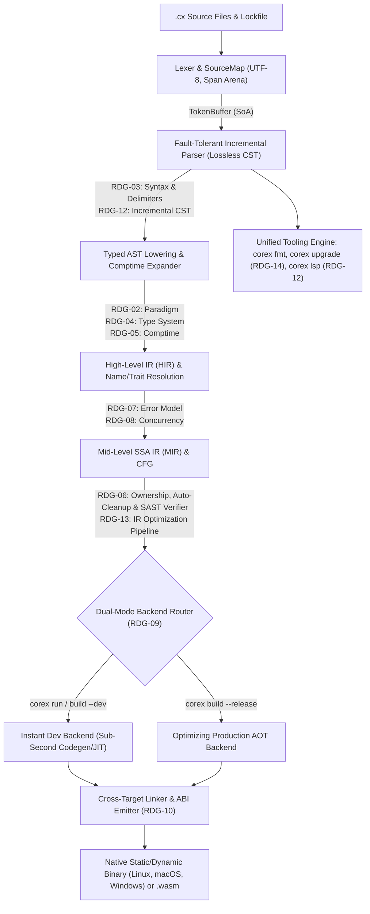

# Master Engineering Roadmap: CoreX (`0.0` → `0.0.1` Self-Hosted → `0.x` → `1.0` Stable)

> *A streamlined, zero-GC, statically typed programming language built for instant compilation, compile-time safety, and C-level runtime speed.*

This document is the canonical engineering roadmap and architectural Single Source of Truth (SSOT) for taking **CoreX** (`corex-lang/corex`, `.cx`) from Phase 0 to its 100% self-hosted **`v0.0.1`** initial release (`Phase 12`), through **post-`v0.0.1` (`0.x`)** capabilities and real-world maturation (`Phase 13+`), and ultimately to a battle-tested **`v1.0.0`** first stable release.

---

## 1. Architectural Overview & Research Decision Gates (`RDG`)

To guarantee that no compiler subsystem prematurely hardcodes algorithms or syntax choices that belong to `Deep research`, the compiler is architected around strict **representation boundaries** and **19 Research Decision Gates (`RDG-01`–`RDG-19`)**. Each gate maps 1-to-1 to its prompt in [docs/research/PROMPTS.md](docs/research/PROMPTS.md) and its resolved specification report at `docs/research/DR-XX.md`.

| Gate ID      | Research Specification Report                                   | Blocking Phase   | Modular Boundary / Interface Governed                                                                          |
| ------------ | --------------------------------------------------------------- | ---------------- | -------------------------------------------------------------------------------------------------------------- |
| **`RDG-01`** | [`docs/research/DR-01.md`](docs/research/DR-01.md)              | Phase 0          | Bootstrap implementation language, build scripts, arena allocator primitives, self-hosting seed strategy       |
| **`RDG-02`** | [`docs/research/DR-02.md`](docs/research/DR-02.md)              | Phase 2          | Programming paradigm, expression vs. statement semantics, mutability defaults, data composition model          |
| **`RDG-03`** | [`docs/research/DR-03.md`](docs/research/DR-03.md)              | Phase 1 / 2      | Ergonomic syntax, `TokenKind` table, block/generic delimiters, grammar production rules, casing rules          |
| **`RDG-04`** | [`docs/research/DR-04.md`](docs/research/DR-04.md)              | Phase 4          | `TypeArena`, bidirectional constraint solver, constrained type groups (`Number`), variance rules               |
| **`RDG-05`** | [`docs/research/DR-05.md`](docs/research/DR-05.md)              | Phase 5          | `MirInterpreter` / `comptime` evaluator, type-level evaluation, compile-time reflection hooks                  |
| **`RDG-06`** | [`docs/research/DR-06.md`](docs/research/DR-06.md)              | Phase 6          | Zero-GC automatic scope cleanup, interprocedural escape/alias inference, manual allocators, `MIR` SAST engine  |
| **`RDG-07`** | [`docs/research/DR-07.md`](docs/research/DR-07.md)              | Phase 4 / 6      | Zero-overhead error union representation, register/flag ABI lowering, exhaustiveness diagnostics               |
| **`RDG-08`** | [`docs/research/DR-08.md`](docs/research/DR-08.md)              | Phase 8 / 11     | Structured concurrency, coroutine/task lowering, data-race verification, OS I/O completion reactor             |
| **`RDG-09`** | [`docs/research/DR-09.md`](docs/research/DR-09.md)              | Phase 7          | `CodegenBackend` trait, instant `--dev` machine-code emitter/JIT, optimizing `--release` AOT pass pipeline     |
| **`RDG-10`** | [`docs/research/DR-10.md`](docs/research/DR-10.md)              | Phase 8          | Cross-compilation target descriptors, standalone static/dynamic linking, C FFI ABI marshaler, `wasm32` emitter |
| **`RDG-11`** | [`docs/research/DR-11.md`](docs/research/DR-11.md)              | Phase 9          | Zero-friction URL/registry imports, content-addressable store (`~/.corex/cache`), `corex.lock` schema          |
| **`RDG-12`** | [`docs/research/DR-12.md`](docs/research/DR-12.md)              | Phase 2 / 3 / 10 | Fault-tolerant lossless CST, incremental query database (`CompilerDb`), early-cutoff invalidation, `corex lsp` |
| **`RDG-13`** | [`docs/research/DR-13.md`](docs/research/DR-13.md)              | Phase 5          | Desugared `HIR` nodes, basic-block SSA `MIR` with place projections, SROA/inlining/DCE/monomorphization        |
| **`RDG-14`** | [`docs/research/DR-14.md`](docs/research/DR-14.md)              | Phase 3 / 10     | Canonical CST pretty-printer (`corex fmt`), zero-legacy automated spec migration engine (`corex upgrade`)      |
| **`RDG-15`** | [`docs/research/DR-15.md`](docs/research/DR-15.md)              | Phase 11               | Stage-2 `.cx` standard library (`std::cli`, `std::tui`, `std::fs`, `std::net`, `std::http`, `std::ui`)         |
| **`RDG-16`** | [`docs/research/DR-16.md`](docs/research/DR-16.md)              | Phase 9 / 10           | Dependency-conflict solution synthesis, security-aware ranking, and lossless `corex.toml` interactive/LSP fix  |
| **`RDG-17`** | [`docs/research/DR-17.md`](docs/research/DR-17.md)              | Phase 6 / 9 / 10       | Zero-annotation `MIR` call-graph capability inference, supply-chain sandboxing, and `@no_alloc` / `@no_panic`  |
| **`RDG-18`** | [`docs/research/DR-18.md`](docs/research/DR-18.md)              | Phase 7 / 8 / 11       | Deterministic `Context` simulation testing (`corex test --sim`) and native coverage fuzzing (`corex test --fuzz`) |
| **`RDG-19`** | [`docs/research/DR-19.md`](docs/research/DR-19.md)              | Phase 7 (Seam) / 13    | Stateful live hot-code reloading (`corex run --watch`), `@must_vectorize` SIMD contracts, and cluster sim      |

---

## 2. Canonical Compiler Data Structures & Pipeline Interfaces

Regardless of the specific surface grammar (`RDG-03`) or backend (`RDG-09`) selected by research, the compiler's internal data structures are fixed around cache-friendly, arena-allocated Structure-of-Arrays (SoA) tables indexed by strongly typed 32-bit handles:

1.  **Compact Handle Primitives (`u32` Non-Exhaustive Enums with `0xFFFFFFFF` `none` Sentinel):**
    -   `FileId(u32)` – Indexes into `VfsSourceMap.files` (`DR-11` §2.4).
    -   `Span { file_id: FileId, start_byte: u32, end_byte: u32 }` – 12-byte (`extern struct`) exact byte range within `file_id`; line/column coordinates (`{ line: u32, col_utf8: u32, col_utf16: u32 }`) are resolved lazily via binary search over `LineIndex` (`line_starts: []const u32`) only when rendering diagnostics or LSP responses (`DR-01` §4.1, `DR-11` §2.4, `DR-12` §1.4 & §4.2).
    -   `SymbolId(u32)` (aliased as `StringId` in `DR-01`/`DR-04`/`DR-11`/`DR-12`) – Interned UTF-8 identifier/string handle via a shard-locked `StringInterner` backed by a contiguous `BumpArena` byte slab and an open-addressed hash table keyed by `Wyhash(0)` 64-bit hashes.
    -   `TokenId(u32)` (aliased as `TokenIndex` in `DR-01`/`DR-12`/`DR-14`), `CstNodeId(u32)` (aliased as `CstNodeIndex` in `DR-12`/`DR-14`), `AstNodeId(u32)` (aliased as `NodeIndex` in `DR-01`/`DR-04`/`DR-12`/`DR-13`), `HirId(u32)` (aliased as `HirIndex` in `DR-13`), `MirBlockId(u32)`, `MirValueId(u32)`, `TypeId(u32)`, `ScopeId(u32)`, `RegionId(u32)`, `DiagId(u32)`.
2.  **`SourceMap` & Virtual File System (`VfsSourceMap`):**
    -   Maps `FileId` to contiguous UTF-8 byte buffers (supporting memory-mapped disk files for CLI builds and in-memory overlay buffers for `corex lsp` and `corex fmt`).
    -   Precomputes `LineIndex` (`line_starts: Vec<u32>`) using SIMD newline scanning (`\n`, handling both `LF` and `CRLF`) during file load.
3.  **`TokenBuffer` (SoA Layout):**
    -   Stores parallel contiguous arrays: `kinds: Vec<TokenKind>`, `byte_offsets: Vec<u32>`, `byte_lengths: Vec<u16>`, `flags: Vec<TokenFlags>` (indicating preceding trivia/newline presence and lexical recovery status for the formatter and parser).
    -   Guarantees `O(1)` random token access and fits 64K tokens in `< 512 KB` of L2 cache.
4.  **`LosslessCstArena` & `AstArena`:**
    -   **Lossless Concrete Syntax Tree (CST):** Preserves 100% of source bytes – including comments, whitespace trivia, and malformed error recovery tokens – so `corex fmt`, `corex upgrade`, and `corex lsp` can round-trip any `.cx` file without losing a single byte.
    -   **Typed Abstract Syntax Tree (AST):** Compact, trivia-stripped view lowered from CST nodes into flat arena arrays for fast semantic analysis.
    -   Every syntax construct includes dedicated hole/error variants (`invalid_parse_subtree`, `item_hole`, `stmt_hole`, `expr_hole`, `type_hole`, `pattern_hole`) so syntax errors in one statement never abort type checking or LSP completion in adjacent functions.
5.  **`DiagnosticSink`, Canonical Code Prefix Registry & Monochrome Terminal Renderer:**
    -   Every diagnostic (`Diagnostic`) carries:
        -   `code: DiagnosticCode` – Strongly typed code governed by a non-overlapping prefix registry across all compiler subsystems:
            *   `E00xx` / `W00xx`: CLI, Workspace, Manifest (`corex.toml`), Lockfile (`corex.lock`), and VFS I/O (`DR-11`).
            *   `E01xx` / `W01xx`: Lexical Scanning, UTF-8 Validation, and Literal Diagnostics (`DR-03`, `DR-12`).
            *   `E02xx` / `W02xx`: Syntax Parsing, Delimiter Recovery, and Lexical Casing Diagnostics (`DR-03`, `DR-12`, `DR-14`).
            *   `E03xx` / `W03xx`: MIR SAST Memory, Exclusivity, Region Escape, Bounds, Concurrency, and FFI Safety Diagnostics (`DR-06` §2.5 `E0301`–`E0307`/`W0308`, `DR-08` §6.3 `E0309`, `DR-10` §2.3 `E0308`, `E0310`–`E0312`).
            *   `E04xx` / `W04xx`: Type System, Bidirectional Inference, Trait Conformance, Generic Constraint, and Error Exhaustiveness Diagnostics (`DR-04` §3.1 `E0400`–`E0415`, `DR-07`).
            *   `E05xx` / `W05xx`: `comptime` Virtual Machine (`MirVm`), Step-Limit/Fuel, and MIR Lowering Diagnostics (`DR-05`, `DR-13`).
        -   `severity: Severity` (`Error`, `Warning`, `Note`, `Help`),
        -   `primary_span: Span`,
        -   `secondary_labels: []const LabeledSpan` (arena-allocated slice of secondary spans with explanatory messages),
        -   `suggestions: []const SuggestedFix` (machine-applicable `TextEdit` byte replacements with `FixApplicability` per `DR-14` §2.5 for `corex fix`, `corex upgrade`, and LSP quick-fixes).
    -   `DiagnosticSink` enforces an explicit upper bound on emitted errors (`max_errors: u32 = 100`) per `AGENTS.md` Section 2 before halting emission with a summary note.
    -   Renders exclusively through the centralized terminal renderer (`.agents/skills/docs/SKILL.md` §4 and `DR-15.md` §2.1.2) using ANSI escape sequences and monochrome Unicode box-drawing characters (`╭`, `│`, `╰`, `├`, `─`, `▸`, `•`, `✓`, `✗`, `⚠`), respecting `NO_COLOR`, `--color=always|auto|never`, and terminal width detection.
6.  **Canonical Cross-Report Specification Invariants (`DR-01`–`DR-15`):**
    -   **Unified Binary Name:** The compiler and toolchain binary is always **`corex`** (`build/stage0/corex`, `build/stage1/corex`, `build/stage2/corex`).
    -   **Error Handling Model (`DR-03` & `DR-07`):** CoreX uses algebraic **`Result[T, E]`** and **`T?`** (`Option[T]`) with postfix **`expr?`** propagation, infix **`expr catch |err| { … }`**, and lexical **`defer` / `errdefer`** (superseding early `E!T` and prefix `try` notations).
    -   **Parameter Modes & Surface Borrowing (`DR-02`, `DR-03`, `DR-06`, `DR-15`):** Surface `.cx` syntax uses **`&T`** (shared immutable borrow, default for parameter passing), **`&mut T`** (exclusive mutable borrow), **`own T`** (consuming move transfer), and **`ref mut T`** (uninitialized out-parameter), lowering 1-to-1 into `HIR`/`MIR` parameter modes **`let`**, **`inout`**, **`sink`**, and **`set`**.
    -   **Square-Bracket Generics (`DR-03`):** Generic parameters and arguments always use square brackets **`[T]`** (`Vec[T]`, `Result[T, E]`, `SlotMap[K, V]`).
    -   **Unified `TokenKind` Table (`DR-03`, `DR-04`, `DR-05`, `DR-07`, `DR-12`):** Includes all base tokens from `DR-03` §5.2 plus `kw_comptime`, `kw_catch`, `kw_errdefer`, `kw_is`, `kw_bit_field`, `#soa` (`hash_soa`), wrapping operators `+%`, `-%`, `*%`, saturating operators `+|`, `-|`, `*|`, and underlying-type approximation `~`.

---

## 3. Step-by-Step Engineering Phases (`Phase 0` → `Phase 12` `v0.0.1` Self-Hosted + `Phase 13` Post-`v0.0.1`)

### Phase 0: Bootstrap Foundation, Terminal Renderer & Verification Harness

-   **Prerequisite Gate:** **`RDG-01`** ([`docs/research/DR-01.md`](docs/research/DR-01.md) – Bootstrap Implementation Language & Build System).
-   **Deliverables:**
    1.  Initialize the Stage 0 compiler workspace in the chosen bootstrap systems language with maximum static analysis and `-Werror` enforcement.
    2.  Implement core foundational arenas: `BumpArena`, `StringInterner`, `SourceMap`, `Vfs`, and `Span` line/column lookup.
    3.  Implement the centralized CLI & Diagnostic Rendering Engine (`cli::style`, `cli::box_draw`, `diag::renderer`):
        -   Monochrome Unicode glyph registry (`╭`, `│`, `╰`, `├`, `─`, `▸`, `•`, `✓`, `✗`, `⚠`).
        -   Multi-line and single-line source snippet renderer with Unicode underline carets and inline fix diff previews.
        -   CLI command router (`corex build`, `corex run`, `corex check`, `corex test`, `corex fmt`, `corex upgrade`, `corex lsp`, `corex bench`).
    4.  Implement the automated test runner (`tests/unit`, `tests/snapshots`, `tests/compile_fail`, `tests/run_pass`, `tests/fuzz`) and benchmark harness (`bench/`).
-   **Verification Gate:**
    -   100% unit test coverage on `BumpArena`, `StringInterner`, `SourceMap` (both `LF` and `CRLF` files, multi-byte UTF-8 boundaries), and golden snapshot tests for single-span, multi-span, and cross-file diagnostic rendering.
    -   Drift guard test confirming zero colored emojis exist anywhere in the repository.

### Phase 1: High-Speed Lexer & Token Stream Architecture

-   **Prerequisite Gate:** **`RDG-03`** ([`docs/research/DR-03.md`](docs/research/DR-03.md) – Lexical Token Specification & Literal Formats).
-   **Deliverables:**
    1.  Implement the zero-allocation deterministic lexer scanning UTF-8 byte buffers into `TokenBuffer`.
    2.  Support all identifier classes, numeric literals (integers, floats, explicit bit-width suffixes if specified by `RDG-03`, hex/binary/octal, visual `_` separators), UTF-8 string/character literals, raw strings, string interpolation tokens, comments (line, block, doc comments), and block delimiters.
    3.  Implement lexical error recovery: invalid UTF-8 sequences, unterminated string literals, or invalid numeric suffixes emit a structured diagnostic into `DiagnosticSink` and produce a `TokenKind::Error` token so lexing always completes in a single linear pass.
-   **Verification Gate:**
    -   Golden token snapshot suite covering all valid and malformed lexical constructs.
    -   Fuzzing gate: 10,000,000 random and mutated byte inputs fed into the lexer with zero crashes, zero hangs, and throughput `>= 2 GB/sec` per core.

### Phase 2: Fault-Tolerant Incremental Parser & Lossless CST/AST

-   **Prerequisite Gates:** **`RDG-02`** ([`docs/research/DR-02.md`](docs/research/DR-02.md) – Paradigm), **`RDG-03`** ([`docs/research/DR-03.md`](docs/research/DR-03.md) – Grammar & Delimiters), **`RDG-12`** ([`docs/research/DR-12.md`](docs/research/DR-12.md) – Lossless CST & Incremental Reparsing).
-   **Deliverables:**
    1.  Implement the recursive-descent + Pratt precedence parser producing the `LosslessCstArena` and lowering to `AstArena`.
    2.  Enforce explicit block delimiter synchronization sets (recovery anchors on block delimiters and top-level declaration keywords) so a syntax error inside an expression or block recovers at the next statement or delimiter without cascading false errors.
    3.  Enforce hard recursion depth caps (`MAX_PARSE_DEPTH = 512`) to prevent stack overflow on pathological nested inputs.
    4.  Implement incremental re-parsing: given an edit byte range `(start_byte, old_end_byte, new_end_byte)`, re-lex and re-parse only the invalidated syntax subtree.
-   **Verification Gate:**
    -   Lossless round-trip invariant test: for every `.cx` file in the test and fuzz corpus, concatenating the leaf tokens/trivia of the CST reproduces the exact input byte buffer bit-for-bit.
    -   Incremental equivalence test: random text edits applied incrementally produce the exact same CST as a full scratch parse.

### Phase 3: Early Formatter (`corex fmt`) & Incremental Query Engine Skeleton

-   **Prerequisite Gates:** **`RDG-12`** ([`docs/research/DR-12.md`](docs/research/DR-12.md) – Query Engine), **`RDG-14`** ([`docs/research/DR-14.md`](docs/research/DR-14.md) – Formatter Algorithm).
-   **Deliverables:**
    1.  Implement the demand-driven incremental query database (`CompilerDb`) tracking fine-grained dependencies (`parse_cst(FileId)` → `lower_ast(FileId)` → `resolve_symbols(ModuleId)` → `typecheck_item(DefId)`).
    2.  Implement `corex fmt` on top of the `LosslessCstArena` so every `.cx` test fixture and stdlib file written from Phase 3 onward is formatted canonically from day one.
-   **Verification Gate:**
    -   Idempotency property test: `fmt(fmt(source)) == fmt(source)` across 100,000 generated and mutated CSTs, preserving 100% of comments.

### Phase 4: Name Resolution, Type System, Constrained Type Groups & Error Semantics

-   **Prerequisite Gates:** **`RDG-04`** ([`docs/research/DR-04.md`](docs/research/DR-04.md) – Type System & Constrained Type Groups), **`RDG-07`** ([`docs/research/DR-07.md`](docs/research/DR-07.md) – Error Handling Model).
-   **Deliverables:**
    1.  Implement module-level and lexical scope resolution (`SymbolTable`, hygiene/visibility checking, unused binding detection, and typo Levenshtein/Jaro-Winkler suggestions).
    2.  Implement the `TypeArena` and bidirectional / local constraint type inference engine:
        -   Primitive types, composite types (structs/records, tuples, tagged enums/unions, slices, fixed arrays, pointers/references, function types).
        -   **Constrained Type Groups** (e.g., `Number`, `Integer`, `Float`, `Signed`, `Comparable`, `Hashable`, plus user-defined type groups) that provide clean, concise function signatures while resolving and monomorphizing to exact concrete machine types at compile time with zero vtable/boxing overhead.
    3.  Implement the error handling type checking and propagation rules defined by `RDG-07` (exhaustiveness checking, zero-cost error propagation, unhandled error compile-fail diagnostics).
-   **Verification Gate:**
    -   Comprehensive `compile_fail` suite verifying exact type mismatch diagnostics, constrained type group violation messages, and exhaustiveness checks.
    -   Zero-allocation hot-path benchmarks on type inference over 100K-line synthetic `.cx` modules.

### Phase 5: High-Level IR (`HIR`), Compile-Time Execution (`comptime`) & Mid-Level SSA IR (`MIR`)

-   **Prerequisite Gates:** **`RDG-05`** ([`docs/research/DR-05.md`](docs/research/DR-05.md) – Compile-Time Execution & Metaprogramming), **`RDG-13`** ([`docs/research/DR-13.md`](docs/research/DR-13.md) – HIR & SSA MIR Architecture).
-   **Deliverables:**
    1.  Implement `AST` → `HIR` lowering: desugaring syntactic sugar, resolving overloaded operators and type groups, and normalizing control flow.
    2.  Implement `HIR` → `MIR` lowering: constructing explicit Control Flow Graphs (CFGs) in Static Single Assignment (SSA) form with explicit place projections, dominance frontiers, and scope termination edges.
    3.  Implement the deterministic `MIR` Compile-Time Evaluator (`comptime` engine per `RDG-05`):
        -   Sandboxed, deterministic execution of `.cx` functions and type-level computations at compile time.
        -   Strict step-count budget (`--comptime-limit`) and deterministic virtual memory model to catch infinite loops or compile-time out-of-bounds reads with full stack-trace diagnostics.
    4.  Implement monomorphization and `MIR` optimization passes (constant propagation, dead-block elimination, Scalar Replacement of Aggregates (SROA), inlining).
-   **Verification Gate:**
    -   `MIR` well-formedness verifier run after every single pass (dominance invariant, SSA single-definition invariant, type consistency).
    -   Snapshot and execution tests for `comptime` evaluation, generic specialization, and compile-time reflection/code generation.

### Phase 6: Zero-GC Memory Management & Static Vulnerability Analysis (`SAST`) Engine

-   **Prerequisite Gates:** **`RDG-06`** ([`docs/research/DR-06.md`](docs/research/DR-06.md) – Zero-GC Memory Model & Static Vulnerability Verifier), **`RDG-17`** ([`docs/research/DR-17.md`](docs/research/DR-17.md) – Call-Graph Capability Inference & `@no_alloc` / `@no_panic` Contracts).
-   **Deliverables:**
    1.  Implement the **Automatic Compile-Time Memory Manager** on `MIR`:
        -   Automatic deterministic scope-based deallocation, move/copy elision, region/escape inference, or compile-time reference count / borrow optimization as specified by `RDG-06`.
        -   Automatic insertion of deterministic cleanup/drop calls along all normal and early-return/error CFG edges.
    2.  Implement the **Manual Memory Control Intrinsics & Custom Allocator Interface**:
        -   Explicit arena, pool, fixed-buffer, and raw pointer/layout primitives for systems-level control.
    3.  Implement the **Built-In Static Vulnerability Analysis (SAST) & Lifetime Verifier** on `MIR`:
        -   Path-sensitive dataflow analysis detecting:
            -   **Use-After-Free (UAF)** and dangling pointer/slice escapes across scopes,
            -   **Double-Free** and invalid deallocation targets,
            -   **Memory Leaks** on manual allocations lacking a dominating deallocation or ownership transfer on all exit paths,
            -   **Buffer Overflows / Out-of-Bounds Indexing** via abstract interpretation / range constraint analysis,
            -   **Uninitialized Memory Reads** and data-race aliasing hazards.
        -   Zero lifetime-annotation burden on everyday code: lifetimes and alias summaries are inferred interprocedurally and modularly by the compiler.
    4.  Implement the **Zero-Annotation Call-Graph Capability & Performance Contract Verifier** (`RDG-17`):
        -   Propagate a compact interprocedural effect/capability bitmask (`fs`, `net`, `env`, `process`, `ffi`, `unsafe`, `alloc`, `may_panic`) bottom-up alongside `FnRegionSummary` with zero permission annotations required in `.cx` source code.
        -   Statically enforce opt-in `@no_alloc` and `@no_panic` real-time/kernel contracts and export per-package capability summaries for Phase 9 supply-chain sandboxing.
-   **Verification Gate:**
    -   Extensive `compile_fail/memory/` suite covering every CWE memory vulnerability class (UAF, double-free, leak, stack-return escape, iterator invalidation, out-of-bounds slice access) plus `@no_alloc` / `@no_panic` contract violations and capability inference with zero false negatives and zero false positives on idiomatic `.cx` patterns.

### Phase 7: Dual-Mode Code Generation Backends (`--dev` vs. `--release`) & Stage 1 `core` Intrinsics

-   **Prerequisite Gates:** **`RDG-09`** ([`docs/research/DR-09.md`](docs/research/DR-09.md) – Dual-Mode Backend Architecture), **`RDG-18`** ([`docs/research/DR-18.md`](docs/research/DR-18.md) – `--fuzz` Coverage Counter Instrumentation), **`RDG-19`** ([`docs/research/DR-19.md`](docs/research/DR-19.md) – Forward-Compatible `Atom` / `GOT` Hot-Reload Metadata Seam).
-   **Deliverables:**
    1.  Define the unified `CodegenBackend` interface consuming verified `MIR`.
    2.  Implement the **Development Mode Backend (`corex run` / `corex build --dev`)**:
        -   Ultra-fast single-pass machine code generation (or JIT execution) designed to compile `>= 500,000` LOC/sec with sub-50ms incremental rebuild turnaround.
        -   Reserve the lightweight forward-compatible `Atom` / `GOT` symbol and layout-hash reload metadata table (`RDG-19`) alongside incremental disk binary patching so Phase 13 live stateful hot-reloading requires zero backend redesign.
    3.  Implement the **Production Mode Backend (`corex build --release`) & `--fuzz` Counter Hook**:
        -   Full AOT optimizing pipeline (loop vectorization, register allocation, tail-call optimization, link-time optimization, dead-symbol stripping) emitting native object code that matches or beats `clang -O3` and `rustc -O`.
        -   Expose optional 8-bit edge-coverage counter emission (`SanitizerCoverage` `inline-8bit-counters` per `RDG-18`) exclusively when compiling in `--fuzz` mode, keeping `--release` binaries 100% zero-overhead.
    4.  Implement **Stage 1 Minimal `core` Intrinsics**:
        -   Primitive types (`i8`–`i128`, `u8`–`u128`, `isize`, `usize`, `f32`, `f64`, `bool`, `char`, `str`, slices, raw pointers), atomic intrinsics, SIMD vector intrinsics, panic/abort handler, and thin OS syscall wrappers (`sys::linux`, `sys::macos`, `sys::windows`, `sys::wasi`).
-   **Verification Gate:**
    -   Differential execution harness (`tests/differential/`): every `run_pass` and randomly generated `.cx` program is compiled with both `--dev` and `--release` and verified to produce identical output and exit status.
    -   Benchmark gate (`bench` skill): verify runtime parity (`<= 1.00x`) against C (`clang -O3`) and Rust (`rustc -O`) on micro-benchmarks.

### Phase 8: Cross-Compilation, Standalone Linking, C FFI & WebAssembly (`wasm32`)

-   **Prerequisite Gates:** **`RDG-08`** ([`docs/research/DR-08.md`](docs/research/DR-08.md) – Concurrency Runtime Hooks), **`RDG-10`** ([`docs/research/DR-10.md`](docs/research/DR-10.md) – Cross-Compilation, Linker, C FFI & Wasm), **`RDG-18`** ([`docs/research/DR-18.md`](docs/research/DR-18.md) – `Context` Clock/RNG/Reactor Simulation Seam).
-   **Deliverables:**
    1.  Integrate the zero-dependency cross-compilation and linking pipeline supporting out-of-the-box builds from any host OS to:
        -   `x86_64-linux-gnu` / `musl` and `aarch64-linux-gnu` / `musl`,
        -   `x86_64-apple-darwin` and `aarch64-apple-darwin`,
        -   `x86_64-windows-msvc` / `gnu` and `aarch64-windows-msvc`,
        -   `wasm32-unknown-wasi` and `wasm32-unknown-freestanding`.
    2.  Support user-selectable **standalone static binaries** (`--link=static`, zero external `.so`/`.dll` dependencies where supported by OS) and **dynamic binaries/shared libraries** (`--link=dynamic`, `.so` / `.dylib` / `.dll`).
    3.  Implement zero-overhead **C FFI** and replaceable **`Context` Runtime Hooks**:
        -   Exact C ABI struct layout, calling convention lowering (`SysV64`, `Win64`, `AAPCS64`, `wasm32`), variadic C function calls, and automated or direct C header binding ingestion.
        -   SAST boundary annotations/checks for pointers crossing FFI boundaries.
        -   Ensure OS clocks, entropy, and completion reactor hooks route cleanly through `Context` (`RDG-08`, `RDG-18`) so deterministic simulation tests (`corex test --sim`) can virtualize execution with zero production overhead.
-   **Verification Gate:**
    -   Cross-target binary verification test suite inspecting generated ELF, Mach-O, PE32+, and `.wasm` headers, symbol tables, and executing cross-compiled binaries under native/QEMU/Wasmtime runners.

### Phase 9: Zero-Friction Package Manager, Content-Addressable Global Cache & Lockfiles

-   **Prerequisite Gates:** **`RDG-11`** ([`docs/research/DR-11.md`](docs/research/DR-11.md) – Package Registry, Global Cache & Resolution Architecture), **`RDG-16`** ([`docs/research/DR-16.md`](docs/research/DR-16.md) – Dependency-Conflict Solution Synthesis & Interactive Manifest Quick-Apply), **`RDG-17`** ([`docs/research/DR-17.md`](docs/research/DR-17.md) – Lockfile & Manifest Supply-Chain Capability Sandboxing).
-   **Deliverables:**
    1.  Implement direct URL and registry package imports in `.cx` source files and `corex.toml` manifests (e.g., GitHub repositories `github.com/org/pkg@v1.2.0` or short registry IDs) with automatic on-demand fetching and manifest synchronization during `corex run` / `corex build`.
    2.  Implement the **Content-Addressable Global Cache** (`~/.corex/cache/blake3/<hash>/`):
        -   Every package version/tree is stored once globally on disk, content-addressed by cryptographic BLAKE3 Merkle tree hash, deduplicating files across all projects on the machine and supporting zero-copy hardlink/reflink materialization.
    3.  Implement deterministic dependency resolution, `corex.lock` generation, and **actionable conflict-solution synthesis** (`RDG-11`, `RDG-16`):
        -   Cryptographic integrity verification, offline/frozen modes (`--offline`, `--locked`, `--frozen`), and reproducible hermetic builds.
        -   Whenever a dependency conflict cannot be resolved unambiguously without guessing, emit a clear root-cause explanation (`RDG-11`) paired with pre-verified, ranked resolution options and optional one-step interactive/CLI application to `corex.toml` preserving comments and formatting (`RDG-14`, `RDG-16`).
    4.  Implement **Compile-Time Supply-Chain Capability Sandboxing** (`RDG-17`):
        -   Record compiler-inferred package capability bitmasks (`fs`, `net`, `env`, `process`, `ffi`, `unsafe`) in `corex.lock` and enforce `corex.toml` capability policies so unexpected privilege escalation in transitive dependencies fails compilation before any code executes.
-   **Verification Gate:**
    -   Unit and integration tests using local mock registries and Git repositories verifying version conflict resolution, pre-verified conflict-solution enumeration and comment-preserving `corex.toml` quick-apply, supply-chain capability escalation rejection, corrupt-hash rejection, cache deduplication, and bit-for-bit reproducible builds from `corex.lock`.

### Phase 10: Built-In Tooling Suite (`corex lsp`, `corex check`, `corex fmt`, `corex upgrade`)

-   **Prerequisite Gates:** **`RDG-12`** ([`docs/research/DR-12.md`](docs/research/DR-12.md) – LSP Architecture), **`RDG-14`** ([`docs/research/DR-14.md`](docs/research/DR-14.md) – Zero-Legacy Migration Engine), **`RDG-16`** ([`docs/research/DR-16.md`](docs/research/DR-16.md) – `corex.toml` Conflict Quick-Fix Code Actions), **`RDG-17`** ([`docs/research/DR-17.md`](docs/research/DR-17.md) – Capability & Contract Diagnostics/Hover).
-   **Deliverables:**
    1.  **Language Server (`corex lsp`):**
        -   Built directly into the `corex` binary over JSON-RPC stdio, powered by the Phase 3 incremental query database (`CompilerDb`).
        -   Supports instant semantic tokens, hover documentation & inferred types/capabilities, go-to-definition, find-references, workspace symbols, signature help, inlay hints (inferred types, elided memory scopes), rename refactoring, and inline code actions from `DiagnosticSink::suggestions`.
    2.  **Static Linter & Capability Auditor (`corex check` / `corex lint`):**
        -   Instant type checking, SAST memory verification, `@no_alloc` / `@no_panic` contract verification, package capability auditing (`RDG-17`), and style/idiom lints without running machine code generation.
    3.  **Zero-Legacy Migration Command (`corex upgrade` / `corex fix`):**
        -   Rule-driven CST/AST transformation engine that automatically rewrites `.cx` source files and `corex.toml` manifests from prior specification revisions to the current specification while preserving comments and formatting.
-   **Verification Gate:**
    -   LSP replay benchmark asserting `< 10 ms` P99 keystroke-to-diagnostic and completion latency on a 100,000-LOC workspace.
    -   Migration round-trip tests verifying automated `.cx` upgrades across synthetic specification changes.

### Phase 11: Stage-2 Batteries-Included Standard Library (Written 100% in `.cx`)

-   **Prerequisite Gates:** **`RDG-08`** ([`docs/research/DR-08.md`](docs/research/DR-08.md) – Concurrency/Async), **`RDG-15`** ([`docs/research/DR-15.md`](docs/research/DR-15.md) – Standard Library, TUI & Wasm/Native UI Architecture), **`RDG-18`** ([`docs/research/DR-18.md`](docs/research/DR-18.md) – Deterministic Simulation & Coverage-Guided Fuzzing).
-   **Deliverables:**
    Implement the modular, tree-shakeable `std` library entirely in `.cx` (`stdlib/*.cx`), dogfooding the language and compiler:
    1.  `std::core` & `std::mem` – Allocators (`Arena`, `Pool`, `FixedBuffer`, `System`), smart containers (`Vec`, `Map`, `Set`, `String`, `SmallVec`, `Deque`), slices, and formatting.
    2.  `std::io` & `std::fs` – Buffered/zero-copy readers and writers, cross-platform path resolution (`resolve_path`, `resolve_or_create_path`), filesystem watcher, memory-mapped files.
    3.  `std::cli` & `std::tui` – Declarative, zero-allocation CLI argument/subcommand parser, ANSI/truecolor terminal styling, monochrome Unicode box-drawing widgets, diff/table renderers, and a 60+ FPS retained/immediate-mode Terminal UI (TUI) engine with raw-mode mouse/keyboard event loops.
    4.  `std::async` & `std::net` & `std::http` – Structured concurrency runtime, multi-threaded work-stealing or thread-per-core reactor (`io_uring` on Linux, `IOCP` on Windows, `kqueue` on macOS), TCP/UDP sockets, TLS, and a high-throughput, low-latency HTTP/1.1, HTTP/2, and WebSocket server/client and router.
    5.  `std::serde` & `std::crypto` & `std::time` – Compile-time specialized zero-copy JSON/TOML/binary serialization, BLAKE3/SHA-256/AEAD primitives, monotonic clocks.
    6.  `std::ui` / `std::web` – Unified reactive/declarative UI and canvas/DOM bridge targeting both `wasm32` web applications and lightweight native windows without requiring JavaScript/TypeScript.
    7.  `std::test` & `std::bench` – Native `.cx` test assertions, snapshot testing, **deterministic virtual-time/scheduler/`OOM` fault-injection simulation (`corex test --sim --seed`, `RDG-18`)**, **zero-config coverage-guided native fuzzing with counterexample shrinking and auto-regression snapshots (`corex test --fuzz`, `RDG-18`)**, and hardware PMU micro-benchmarking.
-   **Verification Gate:**
    -   100% test coverage of all `std` modules compiled and executed via `corex test` (including `--sim` deterministic seed replay and `--fuzz` shrinking tests) in both `--dev` and `--release` across Linux, macOS, Windows, and `wasm32`.
    -   Tree-shaking verification: a minimal `std::cli` hello-world program links only the referenced functions and meets the binary size and `< 1.5 ms` cold-start budget.

### Phase 12: Self-Hosting Compiler Rewrite (`.cx`), Bootstrap Fixed-Point & `v0.0.1` Initial Release

-   **Prerequisite Gate:** All prior phases (`Phase 0`–`Phase 11`), `RDG-01`–`RDG-18` ([`docs/research/DR-01.md`](docs/research/DR-01.md)–[`docs/research/DR-18.md`](docs/research/DR-18.md)), and the Phase 7 reload-metadata seam of `RDG-19` complete.
-   **Deliverables:**
    1.  Rewrite the entire CoreX compiler, memory/SAST & capability verifier, dual-mode backend driver, package manager, formatter, upgrader, and LSP in **CoreX itself** (`compiler/*.cx`), utilizing `std::cli` and `std::tui` for its own terminal output.
    2.  Execute the **3-Stage Bootstrap Verification Pipeline** (`build` skill):
        -   `Stage 0` (host bootstrap compiler) compiles `compiler/*.cx` → produces `stage1/corex`.
        -   `Stage 1` (`stage1/corex`) compiles `compiler/*.cx` → produces `stage2/corex`.
        -   `Stage 2` (`stage2/corex`) compiles `compiler/*.cx` → produces `stage3/corex`.
        -   Verify **byte-for-byte SHA-256 identity** between `stage2/corex` and `stage3/corex` across all target platforms.
    3.  Retire the Stage 0 host language source tree (archiving a minimal reproducible bootstrap seed / C transpilation backend if specified by `RDG-01`) so `corex-lang/corex` is 100% self-hosted in `.cx`.
    4.  Run a 72-hour continuous differential fuzzing campaign, full SAST self-verification (`corex check compiler/`), and full C/Rust benchmark suite comparison for the **CoreX `v0.0.1`** initial self-hosted release.

### Phase 13: Post-`v0.0.1` (`0.x`) Capabilities – Live Stateful Hot-Reloading, Hardware SIMD Contracts & Cluster Simulation

-   **Prerequisite Gate:** **CoreX `v0.0.1`** self-hosted toolchain (`Phase 12`) and **`RDG-19`** ([`docs/research/DR-19.md`](docs/research/DR-19.md)) complete (advancing `0.x` toward the eventual battle-tested **`v1.0.0`** first stable release, with `corex upgrade` handling any `0.x` specification evolutions).
-   **Deliverables:**
    1.  **Sub-50ms Stateful Live In-Process Hot-Code Reloading (`corex run --watch`, `RDG-19`):**
        -   Build atop Phase 7's `Atom` / `GOT` reload-metadata seam to hot-patch updated machine code directly into live running `--dev` processes across Linux, macOS, and Windows.
        -   Preserve live `AppState` and `Arena` memory across code edits in `std::tui`, `std::http`, and GPUI-style `std::ui` applications whenever `struct`/`enum` memory layouts are unchanged, and perform clean automatic process restarts when data layouts change, while keeping `--release` builds 100% static zero-indirection AOT binaries.
    2.  **Target-Verified Hardware SIMD & Loop Vectorization Contracts (`@must_vectorize`, `RDG-19`):**
        -   Enforce explicit per-target loop-vectorization guarantees across `x86_64` (`AVX2` / `AVX-512`), `aarch64` (`NEON` / `SVE`), and `wasm32` (`SIMD128`), paired with `corex lsp` inline SIMD lane-width and register-pressure remarks.
    3.  **Multi-Node Deterministic Network & Crash-Consistency Simulation (`RDG-18`, `RDG-19`):**
        -   Extend `corex test --sim` with multi-node virtualized network topologies (packet loss, reordering, partitions) and virtualized crash-consistency filesystem fault injection for distributed `.cx` systems.
-   **Verification Gate:**
    -   Cross-platform (`Linux`, `macOS`, `Windows`) live hot-patch stress suite verifying zero memory corruption across 10,000 sequential function-body edits, clean layout-change restarts, deterministic `@must_vectorize` diagnostics per target CPU, and 100% seed-reproducible multi-node simulation runs.
