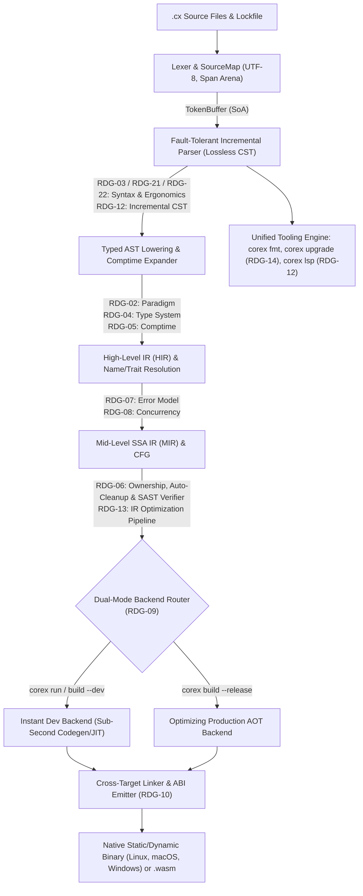

# Master Engineering Roadmap: CoreX (`0.0` → `0.0.1` Self-Hosted → `0.x` → `1.0` Stable)

> *Build reliable software effortlessly at systems-level speed.*

This document is the canonical engineering roadmap and architectural Single Source of Truth (SSOT) for taking **CoreX** (`corex-lang/corex`, `.cx`) from Phase 0 to its 100% self-hosted **`v0.0.1`** initial release (`Phase 12`), through **post-`v0.0.1` (`0.x`)** capabilities and real-world maturation (`Phase 13+`), and ultimately to a battle-tested **`v1.0.0`** first stable release.

---

## 1. Architectural Overview & Research Decision Gates (`RDG`)

To guarantee that no compiler or standard library subsystem prematurely hardcodes algorithms or syntax choices that belong to `Deep research`, the repository is architected around strict **representation boundaries**, **22 Compiler Research Decision Gates (`RDG-01`–`RDG-22`)**, and **7 Standard Library Research Specifications (`STD-01`–`STD-07`)**. Compiler gates map 1-to-1 to [docs/research/PROMPTS.md](docs/research/PROMPTS.md) (`docs/research/DR-XX.md`), while standard library modules map to [docs/research/stdlib/PROMPTS.md](docs/research/stdlib/PROMPTS.md) (`docs/research/stdlib/STD-XX.md`).

| Gate ID      | Research Specification Report                      | Blocking Phase           | Modular Boundary / Interface Governed                                                                             |
| ------------ | -------------------------------------------------- | ------------------------ | ----------------------------------------------------------------------------------------------------------------- |
| **`RDG-01`** | [`docs/research/DR-01.md`](docs/research/DR-01.md) | Phase 0 / 12.1–12.7      | Bootstrap implementation language, build scripts, arena allocator primitives, self-hosting seed strategy          |
| **`RDG-02`** | [`docs/research/DR-02.md`](docs/research/DR-02.md) | Phase 2                  | Programming paradigm, expression vs. statement semantics, mutability defaults, data composition model             |
| **`RDG-03`** | [`docs/research/DR-03.md`](docs/research/DR-03.md) | Phase 1 / 2              | Ergonomic syntax, `TokenKind` table, block/generic delimiters, grammar production rules, casing rules             |
| **`RDG-04`** | [`docs/research/DR-04.md`](docs/research/DR-04.md) | Phase 4                  | `TypeArena`, bidirectional constraint solver, constrained type groups (`Number`), variance rules                  |
| **`RDG-05`** | [`docs/research/DR-05.md`](docs/research/DR-05.md) | Phase 5                  | `MirInterpreter` / `comptime` evaluator, type-level evaluation, compile-time reflection hooks                     |
| **`RDG-06`** | [`docs/research/DR-06.md`](docs/research/DR-06.md) | Phase 6                  | Zero-GC automatic scope cleanup, interprocedural escape/alias inference, manual allocators, `MIR` SAST engine     |
| **`RDG-07`** | [`docs/research/DR-07.md`](docs/research/DR-07.md) | Phase 4 / 6 / 7          | Zero-overhead error union representation, `swiftcc` + `swifterror` ABI lowering, exhaustiveness diagnostics       |
| **`RDG-08`** | [`docs/research/DR-08.md`](docs/research/DR-08.md) | Phase 8 / 11.2 / 13.1    | Structured concurrency, coroutine/task lowering, data-race verification, OS I/O completion reactor                |
| **`RDG-09`** | [`docs/research/DR-09.md`](docs/research/DR-09.md) | Phase 7 / 12.6 / 13.0    | `CodegenBackend` trait, `-ofmt=c` & `--release` LLVM AOT (`Phase 7`), self-hosted Tier C `--dev` (`Phase 13.0`)   |
| **`RDG-10`** | [`docs/research/DR-10.md`](docs/research/DR-10.md) | Phase 8 / 12.6 / 13.3    | Cross-compilation target descriptors, standalone static/dynamic linking, C FFI ABI marshaler, `wasm32` emitter    |
| **`RDG-11`** | [`docs/research/DR-11.md`](docs/research/DR-11.md) | Phase 9 / 12.7           | Zero-friction URL/registry imports, content-addressable store (`~/.corex/cache`), `corex.lock` schema             |
| **`RDG-12`** | [`docs/research/DR-12.md`](docs/research/DR-12.md) | Phase 2 / 3 / 10 / 10.5  | Fault-tolerant lossless CST, incremental query database (`CompilerDb`), early-cutoff invalidation, `corex lsp`    |
| **`RDG-13`** | [`docs/research/DR-13.md`](docs/research/DR-13.md) | Phase 5                  | Desugared `HIR` nodes, basic-block SSA `MIR` with place projections, SROA/inlining/DCE/monomorphization           |
| **`RDG-14`** | [`docs/research/DR-14.md`](docs/research/DR-14.md) | Phase 3 / 10 / 10.5      | Canonical CST pretty-printer (`corex fmt`), zero-legacy automated spec migration engine (`corex upgrade`)         |
| **`RDG-15`** | [`docs/research/DR-15.md`](docs/research/DR-15.md) + [`STD-01`–`07`](docs/research/stdlib/PROMPTS.md) | Phase 11.1–11.3 / 13 | 5-Tier `cx.*` DAG (`DR-15`), bootstrap `STD-01`–`STD-04` (`11.1`–`11.3`), and `STD-05`–`STD-07` (`13.1`–`13.4`) |
| **`RDG-16`** | [`docs/research/DR-16.md`](docs/research/DR-16.md) | Phase 9 (Seam) / 13.2    | Dependency-conflict solution synthesis, security-aware ranking, and lossless `corex.toml` interactive/LSP fix     |
| **`RDG-17`** | [`docs/research/DR-17.md`](docs/research/DR-17.md) | Phase 6 / 9 / 10         | Zero-annotation `MIR` call-graph capability inference, supply-chain sandboxing, and `@no_alloc` / `@no_panic`     |
| **`RDG-18`** | [`docs/research/DR-18.md`](docs/research/DR-18.md) | Phase 7 / 8 / 11.3       | Deterministic `Context` simulation testing (`corex test --sim`) and native coverage fuzzing (`corex test --fuzz`) |
| **`RDG-19`** | [`docs/research/DR-19.md`](docs/research/DR-19.md) | Phase 7 (Seam) / 13      | Stateful live hot-code reloading (`corex run --watch`), `@must_vectorize` SIMD contracts, and VOPR cluster sim    |
| **`RDG-20`** | [`docs/research/DR-20.md`](docs/research/DR-20.md) | Phases 6–13              | Holistic superpower catalog (`D-01`–`D-11`), soundness/ABI fixes (`Prune-01`–`07`), and `195-LOC` seam map        |
| **`RDG-21`** | [`docs/research/DR-21.md`](docs/research/DR-21.md) | Phase 7.5 / Phases 8–13  | `cx.*` standard namespace, unified `.` path separator (retiring `::`), and `SE-01`–`SE-08` surface elevations     |
| **`RDG-22`** | [`docs/research/DR-22.md`](docs/research/DR-22.md) | Phase 7.6 / Phases 8–13  | Canonical CoreX v1.0 surface lock (`ADR-22A`–`22F`), `120`-token table, and `SE-09`–`SE-23` zero-cost advantages  |

---

## 2. Canonical Compiler Data Structures & Pipeline Interfaces

Regardless of the specific surface grammar (`RDG-03`) or backend (`RDG-09`) selected by research, the compiler's internal data structures are fixed around cache-friendly, arena-allocated Structure-of-Arrays (SoA) tables indexed by strongly typed 32-bit handles:

1.  **Compact Handle Primitives (`u32` Non-Exhaustive Enums with `0xFFFFFFFF` `none` Sentinel):**
    -   `FileId(u32)` – Indexes into `VfsSourceMap.files` (`DR-11` §2.4).
    -   `Span { file_id: FileId, start_byte: u32, end_byte: u32 }` – 12-byte (`extern struct`) exact byte range within `file_id`; line/column coordinates (`{ line: u32, col_utf8: u32, col_utf16: u32 }`) are resolved lazily via binary search over `LineIndex` (`line_starts: []const u32`) only when rendering diagnostics or LSP responses (`DR-01` §4.1, `DR-11` §2.4, `DR-12` §1.4 & §4.2).
    -   `SymbolId(u32)` (aliased as `StringId` in `DR-01`/`DR-04`/`DR-11`/`DR-12`) – Interned UTF-8 identifier/string handle via a shard-locked `StringInterner` backed by a contiguous `BumpArena` byte slab and an open-addressed hash table keyed by `Wyhash(0)` 64-bit hashes.
    -   `TokenId(u32)` (aliased as `TokenIndex` in `DR-01`/`DR-12`/`DR-14`), `CstNodeId(u32)` (aliased as `CstNodeIndex` in `DR-12`/`DR-14`), `AstNodeId(u32)` (aliased as `NodeIndex` in `DR-01`/`DR-04`/`DR-12`/`DR-13`), `HirId(u32)` (aliased as `HirIndex` in `DR-13`), `MirBlockId(u32)`, `MirValueId(u32)`, `TypeId(u32)`, `ScopeId(u32)`, `RegionId(u32)`, `DiagId(u32)`.
2.  **`SourceMap` & Virtual File System (`VfsSourceMap`):**
    -   Maps `FileId` to contiguous UTF-8 byte buffers (supporting memory-mapped disk files for CLI builds and in-memory overlay buffers for `corex lsp` and `corex fmt`).
    -   Precomputes `LineIndex` (`line_starts: Vec<u32>`) using SIMD newline scanning (`\n`, handling both `LF` and `CRLF`) during file load.
3.  **`TokenBuffer` (SoA Layout):**
    -   Stores parallel contiguous arrays: `kinds: Vec<TokenKind>`, `byte_offsets: Vec<u32>`, `byte_lengths: Vec<u16>`, `flags: Vec<TokenFlags>` (indicating preceding trivia/newline presence and lexical recovery status for the formatter and parser).
    -   Guarantees `O(1)` random token access and fits 64K tokens in `< 512 KB` of L2 cache.
4.  **`LosslessCstArena` & `AstArena`:**
    -   **Lossless Concrete Syntax Tree (CST):** Preserves 100% of source bytes – including comments, whitespace trivia, and malformed error recovery tokens – so `corex fmt`, `corex upgrade`, and `corex lsp` can round-trip any `.cx` file without losing a single byte.
    -   **Typed Abstract Syntax Tree (AST):** Compact, trivia-stripped view lowered from CST nodes into flat arena arrays for fast semantic analysis.
    -   Every syntax construct includes dedicated hole/error variants (`invalid_parse_subtree`, `item_hole`, `stmt_hole`, `expr_hole`, `type_hole`, `pattern_hole`) so syntax errors in one statement never abort type checking or LSP completion in adjacent functions.
5.  **`DiagnosticSink`, Canonical Code Prefix Registry & Monochrome Terminal Renderer:**
    -   Every diagnostic (`Diagnostic`) carries:
        -   `code: DiagnosticCode` – Strongly typed code governed by a non-overlapping prefix registry across all compiler subsystems:
            *   `E00xx` / `W00xx`: CLI, Workspace, Manifest (`corex.toml`), Lockfile (`corex.lock`), and VFS I/O (`DR-11`, `DR-16` `E0010`–`E0012`).
            *   `E01xx` / `W01xx`: Lexical Scanning, UTF-8 Validation, and Literal Diagnostics (`DR-03`, `DR-12`, `DR-21` `E0112`, `DR-22` `E0113`–`E0117`).
            *   `E02xx` / `W02xx`: Syntax Parsing, Delimiter Recovery, and Lexical Casing Diagnostics (`DR-03`, `DR-12`, `DR-14`, `DR-21` `E0214`–`E0218`, `DR-22` `E0219`–`E0228`).
            *   `E03xx` / `W03xx`: MIR SAST Memory, Exclusivity, Region Escape, Bounds, Concurrency, FFI, Capabilities, Contracts, and `--sim` Determinism Diagnostics (`DR-06` `E0301`–`E0307`/`W0308`/`E0313`/`W0314`, `DR-08` `E0309`, `DR-10` `E0308`/`E0310`–`E0312`, `DR-20`/`DR-17` `E0315`–`W0330`, `DR-18` `E0331`/`W0332`).
            *   `E04xx` / `W04xx`: Type System, Bidirectional Inference, Trait Conformance, Generic Constraint, and Error Exhaustiveness Diagnostics (`DR-04` §3.1 `E0400`–`E0415`, `DR-07`, `DR-21` `E0416`–`E0419`, `DR-22` `E0420`–`E0437`).
            *   `E05xx` / `W05xx`: `comptime` Virtual Machine (`MirVm`), Step-Limit/Fuel, MIR Lowering, and `@must_vectorize` Loop Contract Diagnostics (`DR-05`, `DR-13`, `DR-19` `E0520`–`E0522`).
        -   `severity: Severity` (`Error`, `Warning`, `Note`, `Help`),
        -   `primary_span: Span`,
        -   `secondary_labels: []const LabeledSpan` (arena-allocated slice of secondary spans with explanatory messages),
        -   `suggestions: []const SuggestedFix` (machine-applicable `TextEdit` byte replacements with `FixApplicability` per `DR-14` §2.5 for `corex fix`, `corex upgrade`, and LSP quick-fixes).
    -   `DiagnosticSink` enforces an explicit upper bound on emitted errors (`max_errors: u32 = 100`) per `AGENTS.md` Section 2 before halting emission with a summary note.
    -   Renders exclusively through the centralized terminal renderer (`.agents/skills/docs/SKILL.md` §4 and `DR-15.md` §2.1.2) using ANSI escape sequences and monochrome Unicode box-drawing characters (`╭`, `│`, `╰`, `├`, `─`, `▸`, `•`, `✓`, `✗`, `⚠`), respecting `NO_COLOR`, `--color=always|auto|never`, and terminal width detection.
6.  **Canonical Cross-Report Specification Invariants (`DR-01`–`DR-22`):**
    -   **Unified Binary Name:** The compiler and toolchain binary is always **`corex`** (`build/stage0/corex`, `build/stage1/corex`, `build/stage2/corex`, `build/stage3/corex`).
    -   **Error Handling Model & ABI (`DR-03`, `DR-07`, `DR-20` `Fix-07` / `Prune-03`–`04`, `DR-21` `SE-03`, `DR-22` `ADR-22C`):** CoreX uses payload-first algebraic **`T!E`** (`Result[T, E]`) and **`T?`** (`Option[T]`) with postfix **`expr?`** propagation, infix **`expr catch |err| { … }`** (for `T!E`), infix **`expr orelse fallback`** (for `T?`, retiring `Option.unwrap` and `Option.unwrap_or`), `@derive(From)` nominal error upcasting (`SE-10`), and lexical **`defer` / `errdefer`**. On unmodified LLVM 20–23 (`corex_llvm.cpp`), `cx_result_cc` lowers onto `swiftcc` + `swifterror` (`R12` on `x86_64`, `X21` on `AArch64`, `X19` on `Arm64EC`, plus 4 payload GPRs) with zero C++ LSDA personality bloat and mandatory minimal `.pdata`/`.xdata` frame unwind descriptors on Windows.
    -   **Parameter Modes & Surface Borrowing (`DR-02`, `DR-03`, `DR-06`, `DR-15`, `DR-20` `Fix-06B`, `DR-22` `ADR-22B`):** Surface `.cx` syntax uses **`[var] x: T`** (`Copy` by-value, `var` mutates callee copy only), **`x: &T`** (shared immutable borrow), **`x: &mut T`** (exclusive mutable borrow), **`[var] x: own T`** (consuming move transfer requiring active call-site `own` on named `~Copy` values), and **`x: &out T`** (uninitialized out-parameter, retiring `ref`, `inout`, `sink`, `set`, and `let mut`), lowering 1-to-1 into `HIR`/`MIR` parameter modes **`let`**, **`inout`**, **`sink`**, and **`set`**, with post-`yield` `subscript` writebacks lowered onto all normal and `?` exit edges (`DR-20` `Fix-06B`, `DR-22` `SE-21`).
    -   **Square-Bracket Generics (`DR-03`, `DR-22` `SE-09`–`SE-10`):** Generic parameters and arguments always use square brackets **`[T]`** (`Vec[T]`, `SlotMap[K, V]`, inline union bounds `[Data: str | &[u8]]`, and type/const defaults `[H: Hasher = WyHasher]`).
    -   **Unified `TokenKind` Table (`DR-03`, `DR-04`, `DR-05`, `DR-07`, `DR-12`, `DR-21`, `DR-22`):** `120` contiguous `enum(u8)` tokens (`0..119` `< 128` inside `TokenSet128`, leaving `8` spare bits `120..127`), comprising `50` hard keywords (`kw_comptime`, `kw_catch`, `kw_errdefer`, `kw_is`, `kw_bit_field`, `kw_orelse`, `kw_with`, `kw_context`, `kw_unreachable`, `kw_subscript`, `kw_yield`, etc., with `distinct`/`dyn`/`any`/`pkg`/`super`/`out`/`raw`/`inout`/`test`/`bench` parsed as contextual `.ident` modifiers), `.prim_type` (`20` primitives including `opaque`), `.byte_lit` (`b'x'`), `.byte_string_lit` (`b"…"`), `.dotdotdot` (`...`), `#soa` (`hash_soa`), `:=` (`colon_eq`), `$` (`dollar`), wrapping `+%`/`-%`/`*%`, saturating `+|`/`-|`/`*|`, and `~` (with `::`, `ref`, and `&&` retired per `DR-21` & `DR-22`).
    -   **`DR-20` Pre-`v0.0.1` Soundness & Scope Amendments (`Prune-01`–`07`, `Reject-01`):** Whenever an earlier `DR-01`–`DR-19` baseline conflicts with [`docs/research/DR-20.md`](docs/research/DR-20.md) (`Bucket A`, `Bucket B`, `Bucket C`, and the `195-LOC` Seam Reservation Checklist), **`DR-20.md` takes precedence** – specifically demand-sliced Pentagon `Sub` (`MAX_SUB_VARS = 256`), `UnlinkAndReplace` Mach-O emission on macOS, target-ABI byte-array C bitfields, zero `libclang` C++ embedding, and building Tier C native codegen, `DR-16` MaxSAT, `HTTP/2` + `TLS 1.3`, `cx.tui`, and `cx.ui` **1x in `.cx`** across `Phase 13.0`–`13.4` after `v0.0.1` self-hosting.
    -   **`DR-21` Surface Syntax, `cx.*` Namespace & Ergonomic Elevation Precedence (`ADR-21A`–`21C`, `SE-01`–`SE-08`):** Whenever any `DR-01`–`DR-20` snippet or table references `std::`, `::`, `if let` / `while let`, `Option.unwrap` / `Option.unwrap_or`, or `mem.with_arena`, [`docs/research/DR-21.md`](docs/research/DR-21.md) **takes precedence**: public standard modules live under **`cx.*`** (with Stage-1 `core` gated behind `--internal-core`), **`.`** is the sole unified path/member separator (retiring `::` with `E0112`), and CoreX adopts `SE-01` flow-sensitive `is` / `is not` + `and` chains (retiring `if let`/`while let`), `SE-02` parenthesized `(x := expr)` condition bindings, `SE-03` `orelse`, `SE-04` `$` slice length indexing, `SE-05` `for item, i in …`, `SE-06` `T?` labeled value-break loops, `SE-07` `= expr;` functions + named/default call arguments, and `SE-08` lexical `with context.<slot> = expr { … }` blocks.
    -   **`DR-22` Definitive Surface Canonicalization & `SE-09`–`SE-23` Precedence (`ADR-22A`–`22F`, `SE-09`–`SE-23`):** Whenever any `DR-01`–`DR-21` snippet or table uses `&&` / infix `||` / prefix `!x`, `let mut` / `ref` / `inout` / `sink` / `set` / `mut x: T`, user-facing `Result[T, E]` / `Option[T]`, `@attr(k = v)`, `;` struct fields, bare slice `.len` / `.ptr`, `Numeric`, `@noalloc`, `*const T`, `c_void` 0-byte structs, prefix `*ptr`, or `@test fn`, [`docs/research/DR-22.md`](docs/research/DR-22.md) **takes precedence**: locking `and`/`or`/`not` + `~x` (`ADR-22A`), `let`/`var` + `&T`/`&mut T`/`own T`/`&out T` (`ADR-22B`), `T!E` + `T?` (`ADR-22C`), `@attr(k: v)` + `bit_field Name: uN` + `enum Name: Int` + `.len()` + `Number` + `@no_alloc` (`ADR-22D`), `pub(super)` / `pub(pkg)` (`ADR-22E`), `*T` / `*mut T` / `*opaque` + `&raw [mut]` + postfix `ptr.*` (`ADR-22F`), and `SE-09`–`SE-23` (inline `[Data: str | &[u8]]` bounds, generic defaults + `@derive(From)`, `/` & `*` parameter zones, `{x=}` + format specs + zero-alloc `FmtArgs`, `"""…"""` + `b'x'`/`b"…"` + `_u64`, mandatory struct init + `..[own] base`, `(a, b) = (b, a);` parallel swap, prose `test`/`bench` + fuzz params, `@caller_location()`, typed `@cfg(expr)`, 3-tier closures, `cx.async.task_group`, `subscript`/`yield`, `@constructor` + `@builder` UI blocks, and labeled `match` `continue :fsm`).

---

## 3. Step-by-Step Engineering Phases (`Phase 0` → `Phase 12` `v0.0.1` Self-Hosted + `Phase 13` Post-`v0.0.1`)

### Phase 0: Bootstrap Foundation, Terminal Renderer & Verification Harness

-   **Prerequisite Gate:** **`RDG-01`** ([`docs/research/DR-01.md`](docs/research/DR-01.md) – Bootstrap Implementation Language & Build System).
-   **Deliverables:**
    1.  Initialize the Stage 0 compiler workspace in the chosen bootstrap systems language with maximum static analysis and `-Werror` enforcement.
    2.  Implement core foundational arenas: `BumpArena`, `StringInterner`, `SourceMap`, `Vfs`, and `Span` line/column lookup.
    3.  Implement the centralized CLI & Diagnostic Rendering Engine (`cli::style`, `cli::box_draw`, `diag::renderer`):
        -   Monochrome Unicode glyph registry (`╭`, `│`, `╰`, `├`, `─`, `▸`, `•`, `✓`, `✗`, `⚠`).
        -   Multi-line and single-line source snippet renderer with Unicode underline carets and inline fix diff previews.
        -   CLI command router (`corex build`, `corex run`, `corex check`, `corex test`, `corex fmt`, `corex upgrade`, `corex lsp`, `corex bench`).
    4.  Implement the automated test runner (`tests/unit`, `tests/snapshots`, `tests/compile_fail`, `tests/run_pass`, `tests/fuzz`) and benchmark harness (`bench/`).
-   **Verification Gate:**
    -   100% unit test coverage on `BumpArena`, `StringInterner`, `SourceMap` (both `LF` and `CRLF` files, multi-byte UTF-8 boundaries), and golden snapshot tests for single-span, multi-span, and cross-file diagnostic rendering.
    -   Drift guard test confirming zero colored emojis exist anywhere in the repository.

### Phase 1: High-Speed Lexer & Token Stream Architecture

-   **Prerequisite Gate:** **`RDG-03`** ([`docs/research/DR-03.md`](docs/research/DR-03.md) – Lexical Token Specification & Literal Formats).
-   **Deliverables:**
    1.  Implement the zero-allocation deterministic lexer scanning UTF-8 byte buffers into `TokenBuffer`.
    2.  Support all identifier classes, numeric literals (integers, floats, explicit bit-width suffixes if specified by `RDG-03`, hex/binary/octal, visual `_` separators), UTF-8 string/character literals, raw strings, string interpolation tokens, comments (line, block, doc comments), and block delimiters.
    3.  Implement lexical error recovery: invalid UTF-8 sequences, unterminated string literals, or invalid numeric suffixes emit a structured diagnostic into `DiagnosticSink` and produce a `TokenKind::Error` token so lexing always completes in a single linear pass.
-   **Verification Gate:**
    -   Golden token snapshot suite covering all valid and malformed lexical constructs.
    -   Fuzzing gate: 10,000,000 random and mutated byte inputs fed into the lexer with zero crashes, zero hangs, and throughput `>= 2 GB/sec` per core.

### Phase 2: Fault-Tolerant Incremental Parser & Lossless CST/AST

-   **Prerequisite Gates:** **`RDG-02`** ([`docs/research/DR-02.md`](docs/research/DR-02.md) – Paradigm), **`RDG-03`** ([`docs/research/DR-03.md`](docs/research/DR-03.md) – Grammar & Delimiters), **`RDG-12`** ([`docs/research/DR-12.md`](docs/research/DR-12.md) – Lossless CST & Incremental Reparsing).
-   **Deliverables:**
    1.  Implement the recursive-descent + Pratt precedence parser producing the `LosslessCstArena` and lowering to `AstArena`.
    2.  Enforce explicit block delimiter synchronization sets (recovery anchors on block delimiters and top-level declaration keywords) so a syntax error inside an expression or block recovers at the next statement or delimiter without cascading false errors.
    3.  Enforce hard recursion depth caps (`MAX_PARSE_DEPTH = 512`) to prevent stack overflow on pathological nested inputs.
    4.  Implement incremental re-parsing: given an edit byte range `(start_byte, old_end_byte, new_end_byte)`, re-lex and re-parse only the invalidated syntax subtree.
-   **Verification Gate:**
    -   Lossless round-trip invariant test: for every `.cx` file in the test and fuzz corpus, concatenating the leaf tokens/trivia of the CST reproduces the exact input byte buffer bit-for-bit.
    -   Incremental equivalence test: random text edits applied incrementally produce the exact same CST as a full scratch parse.

### Phase 3: Early Formatter (`corex fmt`) & Incremental Query Engine Skeleton

-   **Prerequisite Gates:** **`RDG-12`** ([`docs/research/DR-12.md`](docs/research/DR-12.md) – Query Engine), **`RDG-14`** ([`docs/research/DR-14.md`](docs/research/DR-14.md) – Formatter Algorithm).
-   **Deliverables:**
    1.  Implement the demand-driven incremental query database (`CompilerDb`) tracking fine-grained dependencies (`parse_cst(FileId)` → `lower_ast(FileId)` → `resolve_symbols(ModuleId)` → `typecheck_item(DefId)`).
    2.  Implement `corex fmt` on top of the `LosslessCstArena` so every `.cx` test fixture and stdlib file written from Phase 3 onward is formatted canonically from day one.
-   **Verification Gate:**
    -   Idempotency property test: `fmt(fmt(source)) == fmt(source)` across 100,000 generated and mutated CSTs, preserving 100% of comments.

### Phase 4: Name Resolution, Type System, Constrained Type Groups & Error Semantics

-   **Prerequisite Gates:** **`RDG-04`** ([`docs/research/DR-04.md`](docs/research/DR-04.md) – Type System & Constrained Type Groups), **`RDG-07`** ([`docs/research/DR-07.md`](docs/research/DR-07.md) – Error Handling Model).
-   **Deliverables:**
    1.  Implement module-level and lexical scope resolution (`SymbolTable`, hygiene/visibility checking, unused binding detection, and typo Levenshtein/Jaro-Winkler suggestions).
    2.  Implement the `TypeArena` and bidirectional / local constraint type inference engine:
        -   Primitive types, composite types (structs/records, tuples, tagged enums/unions, slices, fixed arrays, pointers/references, function types).
        -   **Constrained Type Groups** (e.g., `Number`, `Integer`, `Float`, `Signed`, `Comparable`, `Hashable`, plus user-defined type groups) that provide clean, concise function signatures while resolving and monomorphizing to exact concrete machine types at compile time with zero vtable/boxing overhead.
    3.  Implement the error handling type checking and propagation rules defined by `RDG-07` (exhaustiveness checking, zero-cost error propagation, unhandled error compile-fail diagnostics).
-   **Verification Gate:**
    -   Comprehensive `compile_fail` suite verifying exact type mismatch diagnostics, constrained type group violation messages, and exhaustiveness checks.
    -   Zero-allocation hot-path benchmarks on type inference over 100K-line synthetic `.cx` modules.

### Phase 5: High-Level IR (`HIR`), Compile-Time Execution (`comptime`) & Mid-Level SSA IR (`MIR`)

-   **Prerequisite Gates:** **`RDG-05`** ([`docs/research/DR-05.md`](docs/research/DR-05.md) – Compile-Time Execution & Metaprogramming), **`RDG-13`** ([`docs/research/DR-13.md`](docs/research/DR-13.md) – HIR & SSA MIR Architecture).
-   **Deliverables:**
    1.  Implement `AST` → `HIR` lowering: desugaring syntactic sugar, resolving overloaded operators and type groups, and normalizing control flow.
    2.  Implement `HIR` → `MIR` lowering: constructing explicit Control Flow Graphs (CFGs) in Static Single Assignment (SSA) form with explicit place projections, dominance frontiers, and scope termination edges.
    3.  Implement the deterministic `MIR` Compile-Time Evaluator (`comptime` engine per `RDG-05`):
        -   Sandboxed, deterministic execution of `.cx` functions and type-level computations at compile time.
        -   Strict step-count budget (`--comptime-limit`) and deterministic virtual memory model to catch infinite loops or compile-time out-of-bounds reads with full stack-trace diagnostics.
    4.  Implement monomorphization and `MIR` optimization passes (constant propagation, dead-block elimination, Scalar Replacement of Aggregates (SROA), inlining).
-   **Verification Gate:**
    -   `MIR` well-formedness verifier run after every single pass (dominance invariant, SSA single-definition invariant, type consistency).
    -   Snapshot and execution tests for `comptime` evaluation, generic specialization, and compile-time reflection/code generation.

### Phase 6: Zero-GC Memory Management & Static Vulnerability Analysis (`SAST`) Engine

-   **Prerequisite Gates:** **`RDG-06`** ([`docs/research/DR-06.md`](docs/research/DR-06.md) – Zero-GC Memory Model & Static Vulnerability Verifier), **`RDG-17`** ([`docs/research/DR-17.md`](docs/research/DR-17.md) – Call-Graph Capability Inference & `@no_alloc` / `@no_panic` Contracts), **`RDG-20`** ([`docs/research/DR-20.md`](docs/research/DR-20.md) – `D-01`, `D-02`, `D-04`, `D-11`, `Fix-06A/B`, `Fix-17` & `Phase 6` Seams).
-   **Deliverables:**
    1.  Implement the **Automatic Compile-Time Memory Manager** on `MIR`:
        -   Automatic deterministic scope-based deallocation, move/copy elision, and region/escape inference across `Copy`, `AutoDrop`, and `@linear` tiers (`RDG-06`).
        -   Automatic insertion of deterministic cleanup/drop calls along all normal and early-return/error CFG edges, including post-`yield` `subscript` writeback `defer` blocks and un-refilled non-`Copy` projection panic guards (`DR-20` `Fix-06B`).
    2.  Implement **Manual Memory Control, Zero-Unsafe Wire Transmute & Scratch-Arena Exclusivity**:
        -   Explicit `Arena`, `Pool`, `FixedBuffer`, and `unsafe` raw pointer/layout primitives (`RDG-06`).
        -   Zero-`unsafe` layout-verified wire transmutation (`FromBytes` / `IntoBytes` `InternPool` Type Group bits and `@zero_pad` padding zero-fill per `DR-20` `D-01`), plus static 2-slot `Context.scratch[0..2]` ping-pong aliasing verification (`DR-20` `D-04`).
    3.  Implement the **Built-In Static Vulnerability Analysis (SAST) & Lifetime Verifier** on `MIR`:
        -   Path-sensitive dataflow analysis detecting Use-After-Free (`UAF`), double-free, memory/`@linear` leaks, uninitialized reads, MVS exclusivity hazards, and static out-of-bounds indexing via `O(V)` `Intv`-first filtering + Sparse ABCD demand-sliced Pentagon (`MAX_SUB_VARS = 256`, lazy 1-hop join closure per `DR-20` `Fix-06A` / `Prune-05`) and range-proven `.narrow()` integer narrowing (`DR-20` `D-11`).
        -   Zero lifetime-annotation burden on everyday code: lifetimes and alias summaries are inferred interprocedurally and modularly by the compiler.
    4.  Implement **Zero-Annotation Call-Graph Capabilities, `@no_alloc`/`@no_panic`, `@max_stack(N)` & `Phase 6` Seams** (`RDG-17`, `RDG-20`):
        -   Propagate a compact `EffectCapabilityMask` (`fs`, `net`, `env`, `process`, `ffi`, `unsafe`, `alloc`, `may_panic`) and 8-byte stack/frame size summary (`own_frame_bytes`, `max_subtree_bytes` per `DR-20` `D-02`) bottom-up alongside `FnRegionSummary` – enforcing `@no_alloc`, `@no_panic`, `@max_stack(N)`, hermetic `MirVm`, `extern`/`@export`/`@link_name`/`@link_section`/`asm` `ffi|unsafe` tainting, and callback effect propagation (`DR-20` `Fix-17`).
        -   Reserve the `35-LOC` Phase 6 seams (`DR-20` Seam Checklist #1–#2): `TypeFlags.is_secret` (`1 bit` on `distinct` types + `@secret` attribute parse for `Phase 13.1` `D-05`) and a nullable `Context.trace_sink` ring pointer (`Phase 13.2` `D-06B`).
-   **Verification Gate:**
    -   Extensive `compile_fail/memory/` suite covering every CWE memory vulnerability class (`UAF`, double-free, leak, stack-return escape, iterator invalidation, out-of-bounds slice access, scratch-arena rewind conflict, `yield`-projection panic hazard, `@no_alloc`/`@no_panic`/`@max_stack` violations, and `FromBytes`/`IntoBytes` layout rejections) with zero false negatives, zero false positives on idiomatic `.cx`, and `< 2 MB` Pentagon RAM on 4K-SSA functions.

### Phase 7: Stage-0 Bootstrap Backends (`-ofmt=c` & LLVM `--release`), Differential Oracle & Stage 1 `core`

-   **Prerequisite Gates:** **`RDG-09`** ([`docs/research/DR-09.md`](docs/research/DR-09.md) – Backend Architecture), **`RDG-18`** ([`docs/research/DR-18.md`](docs/research/DR-18.md) – `--fuzz` Coverage Counter Hook), **`RDG-19`** ([`docs/research/DR-19.md`](docs/research/DR-19.md) – `Phase 7` Hot-Reload & SIMD Seams), **`RDG-20`** ([`docs/research/DR-20.md`](docs/research/DR-20.md) – `Prune-01`–`04`, `Fix-07`, `D-03`, `D-06A`, `D-07A`, `D-10A`).
-   **Deliverables:**
    1.  Define the unified `CodegenBackend` interface consuming verified `MIR` and implement **Tier A (`-ofmt=c` Deterministic C99 Emitter)** (`RDG-01`, `RDG-09`, `DR-20` `Prune-01` – omitting the disposable Stage-0 Zig copy of Tier C native codegen so Tier C is built `1x` in `.cx` in `Phase 13.0`).
    2.  Implement **Tier B (`corex_llvm.cpp` Static Bridge + Zero-Setup `.ll` → `zig cc` LLVM 20–23 AOT Backend)**, **`--fuzz` Hook & `Phase 7` Seams**:
        -   Full AOT optimizing pipeline emitting MVS `noalias`, Pentagon `!range`, and `#soa` vectorization metadata, lowering `cx_result_cc` onto unmodified LLVM `swiftcc` + `swifterror` (`R12` / `X21` / `X19` + 4 payload GPRs per `DR-20` `Fix-07`), and exposing `SanitizerCoverage` `inline-8bit-counters` in `--fuzz` mode (`RDG-18`) – wired with both the C++20 `corex_llvm.h` / `corex_llvm.cpp` static bridge (gated behind `build.zig` `-Dllvm-prefix=<path>`) and an equivalent in-tree LLVM 20–23 `.ll` emitter compiled via `zig cc` (`Clang` / `LLD`) whenever `-Dllvm-prefix` is unset for zero-setup native compilation.
        -   Implement `O(1)` `MirConst::RawBlob` `@embed_bytes` (`DR-20` `D-03`), mandatory minimal Windows x64/ARM64 `.pdata`/`.xdata` unwind descriptors + non-resident zstd `.debug_line` + 16-slot `--dev` `ErrorReturnTrace` (`DR-20` `D-06A`), target-aware `@cache_aligned` (`64B` x86 / `128B` `aarch64-macos` per `DR-20` `D-10A`), and macOS `UnlinkAndReplace` (`cs_mtime` `SIGKILL`-safe per `DR-20` `Prune-02`).
        -   Reserve the `50-LOC` Phase 7 seams (`DR-20` Seam Checklist #3–#4): `--dev` `GOT` fn-ptr/vtable indirection + `{TypeId, LayoutShapeKey, FieldHash64}` + no-op `cx.runtime.poll_reload()` (`35 LOC`) and `LoopContractMask` on `MIR` loop headers (`15 LOC`).
    3.  Implement **Stage 1 Minimal `core` Intrinsics**:
        -   Primitive types (`i8`–`i128`, `u8`–`u128`, `isize`, `usize`, `f32`, `f64`, `bool`, `char`, `str`, slices, raw pointers), atomic intrinsics, SIMD vector intrinsics, panic/abort handler, and thin OS syscall wrappers (`sys.linux`, `sys.macos`, `sys.windows`, `sys.wasi`).
-   **Verification Gate:**
    -   Differential `MirVm` vs. backend oracle (`corex test --diff-backends` per `DR-20` `D-07A`): every `run_pass` and randomly generated `.cx` program is verified across pre-opt `MirVm`, post-opt `MirVm`, Tier A (`-ofmt=c`), and Tier B (`LLVM`) for identical output and exit status.
    -   Benchmark gate (`bench` skill): verify runtime parity (`<= 1.00x`) against C (`clang -O3`) and Rust (`rustc -O`) on micro-benchmarks.

### Phase 7.5: Surface Syntax, Standard Namespace (`cx.*`) & Zero-Cost Ergonomic Elevation

-   **Prerequisite Gate:** **`RDG-21`** ([`docs/research/DR-21.md`](docs/research/DR-21.md) – `cx.*` Standard Namespace, Unified `.` Paths & `SE-01`–`SE-08` Ergonomic Elevations).
-   **Deliverables:**
    1.  **Lexical & Surface Path Unification (`ADR-21A`–`21C`):** Retire `::` (`.coloncolon`, emitting `E0112` with `SuggestedFix` `"::"` → `"."`); expand `TokenKind` to `117` contiguous `enum(u8)` variants (`< 128` inside `TokenSet128`, adding `.kw_orelse`, `.kw_with`, `.kw_context`, `.kw_unreachable`, `.colon_eq`, and `.dollar`) with `prev_sig_kind != .dot` tuple-projection lexing (`tup.0.1`); implement stateless `isTypeStart` / `isStaticPath` unified `.` parsing across `use` trees, nominal/associated types, static items, and member chains; and route public `cx.*` imports to Stage-1 `core` while gating direct user `use core.*` behind `--internal-core` (`E0218`).
    2.  **Zero-Cost Surface Elevations (`SE-01`–`SE-08`) & `MIR`/Pentagon Integration:** Implement flow-sensitive `is` / `is not` + `and` pattern chains with pre-`else` LIFO `ConditionScope` drops (retiring `if let` and `while let` with `E0216`), parenthesized statically typed `(x := expr)` condition bindings (`E0214`/`E0215`), right-associative `orelse` `(9, 8)` with `|>` elevated to `(10, 11)` (retiring `Option.unwrap` and `Option.unwrap_or`), Pentagon-proven `$` slice/array length indexing (`E0416`) + open ranges (`..b`, `a..`, `..`), `for item, i in …` indexed loops, `T?`-yielding labeled `for`/`while` value-`break` loops, `= expr;` single-expression functions + left-to-right sequenced named/default call arguments (`E0419`), and `.await`-transparent `with context.<slot> = expr { … }` blocks with Pass-3 `Depth(rho_ctx)` escape verification (`E0306`).
    3.  **Canonical Formatter (`corex fmt`) & Stage-0/Stage-1 Corpus Migration:** Update `stage0/src/fmt_engine.zig` for all `DR-21` constructs and migrate all 11 `core/**/*.cx` files, `tests/drift/drift_guard_test.zig`, and all Phase 0–7 `.cx` test/snapshot/benchmark suites cleanly to `DR-21` syntax.
-   **Verification Gate:**
    -   100% green `zig build test`, bit-for-bit lossless CST round-tripping, `fmt(fmt(src)) == fmt(src)` idempotency, `>= 2 GB/sec` lexer throughput, and 4-tier differential backend parity (`pre-opt MirVm`, `post-opt MirVm`, `-ofmt=c`, and `LLVM`) across all migrated and new `DR-21` suites before opening Phase 7.6.

### Phase 7.6: Definitive Surface Syntax Canonicalization & Zero-Cost Language Advantages

-   **Prerequisite Gate:** **`RDG-22`** ([`docs/research/DR-22.md`](docs/research/DR-22.md) – Definitive Surface Syntax Canonicalization, `ADR-22A`–`ADR-22F` & `SE-09`–`SE-23` Zero-Cost Language Advantages).
-   **Deliverables:**
    1.  **One Canonical Way Surface Deduplication (`ADR-22A`–`ADR-22F`):** Retire `.kw_ref` and `.ampamp` while adding `.kw_subscript`, `.kw_yield`, `.byte_lit`, `.byte_string_lit`, and `.dotdotdot` (`120` contiguous `TokenKind`s `0..119`, `70` `KEYWORD_OR_PRIM_MAP` entries with `opaque` at `TypeId 22`); lock word-based `and` / `or` / `not` and integer `~x` (`E0113`, `E0219`, `E0220`), `let`/`var` + `&T`/`&mut T`/`own T`/`&out T` MVS modes with callee-local `var x: T` (`E0221`, `E0420`–`E0422`), payload-first `T!E` + 4-tier `Type` precedence (`E0222`), `@attr(key: val)` (`E0223`), `bit_field Name: uN` + `enum Name: Int` + `as Int` / `bool as Int` casts (`E0224`, `E0423`), `.len()` methods (`E0424`), `Number` + `@no_alloc` (`E0225`), 4-tier `private` < `pub(super)` < `pub(pkg)` < `pub` visibility, and `*T` / `*mut T` / `*opaque` + safe `&raw [mut]` + postfix `ptr.*` (`E0226`, `E0227`, `E0425`).
    2.  **Zero-Cost Surface Elevations (`SE-09`–`SE-23`) & `MIR`/SAST Integration:** Implement PEP 695 inline union bounds `[Data: str | &[u8]]` (`SE-09`), generic type/const defaults + `@derive(From)` (`SE-10`, `E0426`–`E0427`), PEP 570 `/` and PEP 3102 `*` parameter zones (`SE-11`, `E0228`, `E0428`–`E0430`), compile-time `FormatSpec` + `{x=}` + `{{`/`}}` + zero-alloc stack `FmtArgs` (`SE-12`, `E0114`, `E0306`, `E0431`), indent-stripped `"""…"""` + `b'x'`/`b"…"` + `_u64` suffixes (`SE-13`, `E0115`–`E0117`), mandatory struct field init + defaults + MVS-sound `..base` / `..own base` (`SE-14`, `E0304`, `E0432`–`E0433`), struct pattern renaming + 3-phase `(a, b) = (b, a);` parallel swap (`SE-15`, `E0305`, `E0434`), O(1)-skippable `test "…"` / `bench "…"` + fuzz inputs (`SE-16`), 8-byte `.rodata` `@caller_location()` defaults (`SE-17`), native boolean `@cfg(expr)` (`SE-18`, `E0435`), 3-tier closures + `async |g|` `task_group` seams (`SE-19`–`SE-20`), `subscript`/`yield` + multi-index `a[r, c]` (`SE-21`), `@constructor` + `@builder` `PascalCase` UI scopes (`SE-22`, `E0436`), and labeled `match` `continue :fsm` dispatch (`SE-23`, `E0437`).
    3.  **Canonical Formatter (`corex fmt`), `UR-22-00`–`UR-22-06` Registration & Stage-1 Migration:** Update `stage0/src/fmt_engine.zig` (`T!E`/`T?`, `-> unit` omission, inline marker attributes, `42_u64` suffixes, delta-preserving `"""…"""`) and migrate all 12 `core/**/*.cx` files, `tests/drift/drift_guard_test.zig`, and all Phase 0–7.5 `.cx` test/snapshot/benchmark suites cleanly to `DR-22` v1.0 syntax.
-   **Verification Gate:**
    -   100% green `zig build test`, bit-for-bit lossless CST round-tripping, `fmt(fmt(src)) == fmt(src)` idempotency (including nested `"""…"""`), `>= 2 GB/sec` lexer throughput, `< 128` `TokenSet128` assertion, and 4-tier differential backend parity (`pre-opt MirVm`, `post-opt MirVm`, `-ofmt=c`, and `LLVM`) across all migrated and new `DR-22` suites before opening Phase 8.

### Phase 8: Cross-Compilation, Standalone Linking, Declaration C FFI & WebAssembly (`wasm32`)

-   **Prerequisite Gates:** **`RDG-08`** ([`docs/research/DR-08.md`](docs/research/DR-08.md) – Coroutine Lowering & `TaskGroup`), **`RDG-10`** ([`docs/research/DR-10.md`](docs/research/DR-10.md) – Cross-Compilation, Linker, C FFI & Wasm), **`RDG-18`** ([`docs/research/DR-18.md`](docs/research/DR-18.md) – `Context` Simulation Seam), **`RDG-20`** ([`docs/research/DR-20.md`](docs/research/DR-20.md) – `D-02`, `D-11`, `Fix-08B`, `Prune-06` & `Phase 8` Seams), **`RDG-21`** ([`docs/research/DR-21.md`](docs/research/DR-21.md) – `Phase 7.5` Elevated Surface Syntax), **`RDG-22`** ([`docs/research/DR-22.md`](docs/research/DR-22.md) – `Phase 7.6` Canonical v1.0 Surface Lock).
-   **Deliverables:**
    1.  Integrate the zero-dependency cross-compilation and embedded `lld` linking pipeline (`-ffunction-sections -fdata-sections`, `.llvm_addrsig`, `lld --gc-sections --icf=safe` per `DR-20` `D-11`) supporting static (`--link=static`) and dynamic (`--link=dynamic`) builds from any host OS to:
        -   `x86_64-linux-gnu` / `musl` and `aarch64-linux-gnu` / `musl`,
        -   `x86_64-apple-darwin` and `aarch64-apple-darwin` (using `UnlinkAndReplace` + ad-hoc `LC_CODE_SIGNATURE`),
        -   `x86_64-windows-msvc` / `gnu` and `aarch64-windows-msvc`,
        -   `wasm32-unknown-wasi` and `wasm32-unknown-freestanding`.
    2.  Implement **Stackless Coroutine Lowering** (`RDG-08`) with static `16 KiB` caller-inline `async` frame caps (`DR-20` `D-02`), `@linear` `CompletionReaper` socket/handle cleanup on cancelled completions (`DR-20` `Fix-08B`), and the `25-LOC` `Context.reactor: *ReactorVTable` (`monotonic_ns`, `wall_epoch_ns`, `fill_rng`, `submit_io`, …) seam (`DR-20` Seam Checklist #5).
    3.  Implement zero-overhead **C11/C23 Declaration FFI** (`RDG-10`, `DR-20` `Prune-06`, `Reject-01`):
        -   Exact C ABI struct layout, calling conventions (`SysV64`, `Win64`, `AAPCS64`, `wasm32`), variadic C calls, FFI SAST pointer contracts (`@SliceLen`, `@null_terminated`, `@consumes`), and zero-`libclang` in-tree C11/C23 **declaration** ingestion (`typedef`, `enum`, `struct`/`union`, `extern fn`, literal `#define`s) lowering C bitfields into target-ABI byte arrays + `subscript` masks and reserving the `20-LOC` C body AST stub hook (`DR-20` Seam Checklist #6) for `Phase 13.3`.
-   **Verification Gate:**
    -   Cross-target binary verification suite inspecting generated ELF, Mach-O, PE32+ (`.pdata`/`.xdata`), and `.wasm` headers, verifying `SysV` vs. `MSVC` C bitfield ABI parity, `16 KiB` `async` frame diagnostics, and executing cross-compiled binaries under native/QEMU/Wasmtime runners.

### Phase 9: Zero-Friction Package Manager, Content-Addressable Global Cache & Supply-Chain Sandboxing

-   **Prerequisite Gates:** **`RDG-11`** ([`docs/research/DR-11.md`](docs/research/DR-11.md) – Package Registry, Global Cache & PubGrub Resolution), **`RDG-17`** ([`docs/research/DR-17.md`](docs/research/DR-17.md) – Lockfile Supply-Chain Capability Sandboxing), **`RDG-20`** ([`docs/research/DR-20.md`](docs/research/DR-20.md) – `Fix-17`, `Prune-07` & `Phase 9` Seams; plus `RDG-16` 35-LOC Seam).
-   **Deliverables:**
    1.  Implement direct URL and registry package imports in `.cx` source files and `corex.toml` manifests with automatic on-demand fetching and manifest synchronization during `corex run` / `corex build`.
    2.  Implement the **Content-Addressable Global Cache** (`~/.corex/cache/blake3/<hash>/`) with cryptographic BLAKE3 Merkle deduplication and zero-copy hardlink/reflink materialization.
    3.  Implement deterministic **Bounded-MVS + PubGrub** dependency resolution, `corex.lock` generation, cryptographic integrity verification, and hermetic `--offline` / `--locked` / `--frozen` modes (`RDG-11`).
    4.  Implement **Compile-Time Supply-Chain Capability Sandboxing** (`RDG-17`, `DR-20` `Fix-17`) and reserve the `65-LOC` **Phase 9 Seams** (`DR-20` Seam Checklist #7):
        -   Record compiler-inferred package `EffectCapabilityMask` bitmasks (including package-root-jailed `@embed_bytes` and `extern`/`@export`/`@link_name`/`@link_section`/`asm` `ffi|unsafe` taint) in `corex.lock` and enforce `corex.toml` capability policies at compile time.
        -   Export structured PubGrub `Incompatibility` proof DAGs + lossless `corex.toml` CST byte spans (`35 LOC` for `Phase 13.2` `DR-16` MCS/MaxSAT synthesis) and serialize the canonical `.cxi` public API + `EffectCapabilityMask` BLAKE3 digest (`30 LOC` for `Phase 13.1` `D-08` `corex semver-check`).
-   **Verification Gate:**
    -   Integration tests using local mock registries and Git repositories verifying Bounded-MVS + PubGrub proof-tree diagnostics, supply-chain capability escalation rejection, `.cxi` digest determinism, corrupt-hash rejection, cache deduplication, and bit-for-bit reproducible builds from `corex.lock`.

### Phase 10: Built-In Tooling Suite (`corex lsp`, `corex check`, `corex fmt`, `corex upgrade`)

-   **Prerequisite Gates:** **`RDG-12`** ([`docs/research/DR-12.md`](docs/research/DR-12.md) – LSP Architecture), **`RDG-14`** ([`docs/research/DR-14.md`](docs/research/DR-14.md) – Zero-Legacy Migration Engine), **`RDG-17`** ([`docs/research/DR-17.md`](docs/research/DR-17.md) – Capability & Contract Diagnostics/Hover), **`RDG-20`** ([`docs/research/DR-20.md`](docs/research/DR-20.md)), **`RDG-21`** ([`docs/research/DR-21.md`](docs/research/DR-21.md) – `UR-21-00`–`UR-21-07` Upgrade Rules), **`RDG-22`** ([`docs/research/DR-22.md`](docs/research/DR-22.md) – `UR-22-00`–`UR-22-06` Upgrade Rules).
-   **Deliverables:**
    1.  **Language Server (`corex lsp`):**
        -   Built directly into the `corex` binary over JSON-RPC stdio, powered by the Phase 3 incremental query database (`CompilerDb`).
        -   Supports instant semantic tokens, hover documentation & inferred types/capabilities/stack-bounds, go-to-definition, find-references, workspace symbols, signature help, inlay hints (inferred types, elided memory scopes), rename refactoring, and inline code actions from `DiagnosticSink::suggestions`.
    2.  **Static Linter & Capability Auditor (`corex check` / `corex lint`):**
        -   Instant type checking, SAST memory verification, `@no_alloc` / `@no_panic` / `@max_stack` contract verification, package capability auditing (`RDG-17`), and style/idiom lints without running machine code generation.
    3.  **Zero-Legacy Migration Command (`corex upgrade` / `corex fix`):**
        -   Rule-driven CST/AST transformation engine that automatically rewrites `.cx` source files and `corex.toml` manifests from prior specification revisions to the current specification while preserving comments and formatting.
-   **Verification Gate:**
    -   LSP replay benchmark asserting `< 10 ms` P99 keystroke-to-diagnostic and completion latency on a 100,000-LOC workspace.
    -   Migration round-trip tests verifying automated `.cx` upgrades across synthetic specification changes.

### Phase 10.5: Local IDE Support – Official VS Code Extension (`vscode-ext-corex` `v1.0.0`)

-   **Prerequisite Gates:** **`Phase 10`** (`corex lsp` & `corex fmt` live in `build/stage0/corex`), **`RDG-12`** ([`docs/research/DR-12.md`](docs/research/DR-12.md) – LSP Protocol & Semantic Tokens), **`RDG-14`** ([`docs/research/DR-14.md`](docs/research/DR-14.md) – `corex fmt` Integration), **`RDG-21`** ([`docs/research/DR-21.md`](docs/research/DR-21.md)), **`RDG-22`** ([`docs/research/DR-22.md`](docs/research/DR-22.md) – `120` `TokenKind`s & `70` Keywords/Primitives).
-   **Target Workspace, Gold-Standard Reference Repos & Rationale:** Implemented in the dedicated sibling repository **`corex-lang/vscode-ext-corex`** (cloned locally alongside `corex` at `../vscode-ext-corex`, keeping `corex-lang/corex` 100% free of Node/TypeScript extension packaging artifacts per [`docs/LAUNCH.md`](docs/LAUNCH.md) §1), using **`xulbux/vscode-theme-isolux`** (`../vscode-theme-isolux`) and **`xulbux/vscode-ext-color-tracr`** (`../vscode-ext-color-tracr`) as canonical gold-standard reference repositories for directory layout, `README.md` / `CHANGELOG.md` / asset structure, TypeScript/bundler/linter configuration (`pnpm`, `esbuild`, `vitest`, `.oxfmtrc.json`, `.oxlintrc.json`, `.markdownlint.json`), and code style (`"publisher": "corex-lang"`, `"name": "corex"`, `"displayName": "CoreX"`, `"version": "1.0.0"`, `"author": { "name": "XulbuX", "email": "hi@xul.is" }`, `"icon": "assets/icon.png"`). Building and locally dogfooding the extension immediately after `Phase 10` provides full IDE syntax highlighting, live `corex lsp` diagnostics/hover/navigation, and format-on-save (`corex fmt`) *before* authoring `stdlib/cx/` (`Phase 11.1`–`11.3`) and `compiler/` (`Phase 12.1`–`12.7`).
-   **Deliverables:**
    1.  **Agent Rules, Skills & Tooling Bootstrap (Mandatory First Step):**
        -   Before writing any extension code or documentation, inspect `../vscode-theme-isolux` and `../vscode-ext-color-tracr` (`xulbux/vscode-theme-isolux` & `xulbux/vscode-ext-color-tracr`), synthesize and copy their `.agents/AGENTS.md` policies and `.agents/skills/*` workflows (plus `.oxfmtrc.json`, `.oxlintrc.json`, `.markdownlint.json`, and `tsconfig.json` baselines) into `../vscode-ext-corex/.agents/` (preserving the existing `LICENSE` and `assets/icon.png`), and enforce those rules strictly from the very first file onward.
    2.  **Complete CoreX v1.0 TextMate Grammar (`syntaxes/corex.tmLanguage.json`, root scope `source.corex`):**
        -   Cover all `120` `TokenKind`s and `70` keywords/primitives locked in `DR-22`: control, declaration, MVS ownership, and boolean keywords (`fn`, `struct`, `enum`, `bit_field`, `trait`, `impl`, `subscript`, `yield`, `use`, `pub`, `own`, `with`, `context`, `orelse`, `is`, `and`, `or`, `not`, `async`, `await`, `test`, `bench`, `unsafe`, `comptime`), all `20` built-in primitives (`i8`–`i128`, `u8`–`u128`, `isize`, `usize`, `f32`, `f64`, `bool`, `char`, `str`, `unit`, `never`, `opaque`), built-in Constrained Type Groups (`Number`, `Integer`, `Signed`, `Unsigned`, `Float`, `Scalar`, `Bytes`, `Comparable`, `Equatable`, `Copy`, `FromBytes`, `IntoBytes`), `PascalCase` nominal types/variants, `SCREAMING_SNAKE_CASE` constants, `@attr(k: v)` annotations, `:label` / `label:` loop and `match` labels, single-line `"…"`, indent-stripped multiline `"""…"""`, raw `r#"…"#` / `r#"""…"""#`, byte `b'x'` / `b"…"` / `br#"…"#`, nested `{expr=:#06x}` interpolation holes, `{{` / `}}` escapes, and `_`-separated numeric suffixes (`0x4358_u32`, `0.5_f32`).
        -   Assign standard TextMate scope names (`keyword.control.corex`, `storage.type.primitive.corex`, `entity.name.function.corex`, `entity.name.type.corex`, `storage.type.annotation.corex`, etc.) aligned with both `vscode-theme-isolux` and GitHub PrettyLights (`github-linguist/linguist`).
    3.  **Language Configuration (`language-configuration.json`) & Explorer File Icon:**
        -   Configure `//`, `///`, and `//!` line comments, nested `/* … */` block comments, bracket matching and auto-closing pairs (`{}`, `[]`, `()`, `""`, `"""…"""`), smart block indentation, syntax folding markers, built-in `.cx` file-explorer icons (`contributes.languages[0].icon`), and the 5 custom `corex lsp` semantic token modifiers (`mutable`, `consumedMove`, `unsafe`, `attribute`, `linearResource`).
    4.  **Zero-Dependency `corex lsp` & `corex fmt` Client (`src/extension.ts`):**
        -   Ultra-lightweight zero-runtime-dependency JSON-RPC 2.0 `stdio` client (`< 25 KB` `dist/extension.js`, matching `color-tracr`'s minimal-footprint design) spawning `corex lsp`, auto-enabling `--internal-core` (`corex.internalCore: "auto"`) when the CoreX compiler/stdlib workspace is open, wiring in-memory document/range formatting and format-on-save (`corex fmt` CLI fallback if LSP is disabled), and resolving the `corex` binary via `corex.executablePath` or workspace auto-discovery (`build/stage0/corex` during `Phase 11`–`12.5` and self-hosted `corex` from `Phase 12.6` onward).
    5.  **Local-Only `.vsix` Packaging & Dogfooding Install (No Public Release Before `CoreX v0.0.1`):**
        -   Package and install `vscode-ext-corex` **locally only** (`code --install-extension`) for `Phase 11`–`12` development – strictly holding public Visual Studio Marketplace and OpenVSX publishing until *after* `CoreX v0.0.1` ships in [`docs/LAUNCH.md`](docs/LAUNCH.md) Stage `L1`.
-   **Verification Gate:**
    -   Automated TextMate grammar snapshot suite across all `core/**/*.cx` files and [`docs/COMPARISONS.md`](docs/COMPARISONS.md) showcases asserting zero un-scoped syntax tokens, paired with headless LSP client smoke tests (`diagnostics`, `hover`, `definition`, `formatting`) against `build/stage0/corex lsp`.

### Phase 11: Bootstrap `cx.*` Standard Library & Verification Harnesses (`--sim` & `--fuzz`)

-   **Prerequisite Gates:** **`RDG-08`** ([`docs/research/DR-08.md`](docs/research/DR-08.md)), **`RDG-15`** ([`docs/research/DR-15.md`](docs/research/DR-15.md)), **`RDG-18`** ([`docs/research/DR-18.md`](docs/research/DR-18.md)), **`RDG-20`** ([`docs/research/DR-20.md`](docs/research/DR-20.md) `Prune-07`), **`RDG-21`** ([`docs/research/DR-21.md`](docs/research/DR-21.md)), **`RDG-22`** ([`docs/research/DR-22.md`](docs/research/DR-22.md)), plus the four dedicated module-level **`Deep research` specifications (`STD-01`–`STD-04`)** in [`docs/research/stdlib/PROMPTS.md`](docs/research/stdlib/PROMPTS.md) (`docs/research/stdlib/STD-01.md`–`STD-04.md`).
-   **Bootstrap Scope Boundary (`DR-20` `Prune-07`):** Implement the tree-shakeable bootstrap `cx.*` standard modules in `.cx` (`stdlib/cx/*.cx`) required to write and verify `compiler/*.cx`, `corex lsp`, `corex fmt`, `corex upgrade`, and `corex` package management across four independently gated sub-phases (`Phase 11.1`, `11.2a`, `11.2b`, `11.3`), while deferring non-bootstrap application megaprojects (`HTTP/2`, `TLS 1.3`, `cx.tui`, and `cx.ui`, governed by `STD-05`–`STD-07`) to `Phase 13.1`–`13.4` so they are engineered once on the self-hosted toolchain.

#### Phase 11.1: Core Memory, Collections, Strings & Math (`cx` Prelude, `cx.mem`, `cx.col`, `cx.str`, `cx.math`)

-   **Prerequisite Gate:** **`STD-01`** ([`docs/research/stdlib/STD-01.md`](docs/research/stdlib/STD-01.md) via [`docs/research/stdlib/PROMPTS.md`](docs/research/stdlib/PROMPTS.md)).
-   **Deliverables:**
    1.  **`cx` Prelude & `cx.mem` (`stdlib/cx/{mod,mem}.cx`):** `Allocator` trait, LSB-tagged `AllocatorHandle` (`context.allocator` implicit path vs. explicit `&mut Arena` override with static `TrivialDrop` destructor elision), `@linear` 64 KiB page-slab `Arena` (`BumpArena`), `Pool`, `FixedBuffer`, `System`, 2-slot `Context.scratch[0..2]` ping-pong helpers (`D-04`), `Span16`, and zero-`unsafe` layout-verified `view_bytes` / `as_bytes` (`FromBytes` / `IntoBytes`, `D-01`).
    2.  **`cx.col` (`stdlib/cx/col.cx`):** 24-byte `AutoDrop` `Vec[T]`, `#soa Vec[T]`, `SmallVec[T, N]`, `Deque[T]`, generational `SlotMap[K, V]`, `Context.rng`-seeded SIMD/SWAR SwissTable `Map[K, V]` & `Set[T]` (`DR-20` `Fix-18A`) engineered for Pointer-Shape ICF deduplication, and `pdqsort` / binary-search slice algorithms.
    3.  **`cx.str` & `cx.math` (`stdlib/cx/{str,math}.cx`):** 24-byte SSO `String`, SIMD/SWAR UTF-8 validation, `comptime`-frozen `.rodata` Unicode width (`wcwidth`) and grapheme (`UAX #29`) lookup tables (zero pre-`main` runtime initializers), zero-`libc` `Dragonbox`/`Schubfach` float formatting & `Eisel–Lemire` float parsing, zero-allocation `FmtArgs` / `FmtSpec` formatters (`SE-12`), and core scalar/float utilities.
-   **Verification Gate (`11.1`):**
    -   100% `corex test` coverage, `corex check --sast-strict` cleanliness, and 4-tier `--diff-backends` (`Pre-Opt MirVm`, `Post-Opt MirVm`, `-ofmt=c`, `LLVM`) parity across Linux, macOS, Windows, and `wasm32`, verifying zero-instruction `Arena` `TrivialDrop` elision.

#### Phase 11.2a: Zero-Copy I/O, Paths, Filesystem, Clocks, Env & Process (`cx.io`, `cx.path`, `cx.fs`, `cx.time`, `cx.env`, `cx.process`)

-   **Prerequisite Gate:** **`STD-02`** ([`docs/research/stdlib/STD-02.md`](docs/research/stdlib/STD-02.md) via [`docs/research/stdlib/PROMPTS.md`](docs/research/stdlib/PROMPTS.md)).
-   **Deliverables:**
    1.  **`cx.io` (`stdlib/cx/io.cx`):** Zero-copy `Reader`/`Writer`, `BufReader`/`BufWriter`, `LimitReader`, vectored I/O, zero-alloc `FmtArgs` streaming, and locked buffered `stdin`/`stdout`/`stderr`.
    2.  **`cx.path` & `cx.fs` (`stdlib/cx/{path,fs}.cx`):** Cross-OS `Path` / `PathBuf` (Windows `\\?\`, UNC, stack WTF-8 ↔ UTF-16, POSIX, WASI), `@linear` `File` / `Dir` / `Mmap` (`< 16 KiB` arena read vs. `>= 16 KiB` read-only `mmap`), `resolve_path` and `resolve_or_create_path`, `UnlinkAndReplace` atomic file publishing (`Prune-02`), 3-tier reflink/hardlink/copy materialization, file locking, and filesystem change watching.
    3.  **`cx.time`, `cx.env` & `cx.process` (`stdlib/cx/{time,env,process}.cx`):** Overflow-free monotonic `Instant`/`Duration` and `SystemTime` routed through `Context`, XDG/macOS/Windows environment & standard directory resolution, and injection-safe `@linear` child process spawning.
-   **Verification Gate (`11.2a`):**
    -   100% cross-platform `corex test` coverage across Windows (`\\?\`, UNC, CRLF, atomic replace), POSIX, and `wasm32-wasi` VFS paths, plus `DR-17` capability-boundary and `--sim` virtual-clock/VFS verification.

#### Phase 11.2b: Cryptography, Structured Async, Sync & Bootstrap Networking (`cx.crypto`, `cx.async`, `cx.sync`, `cx.net`, `cx.http`)

-   **Prerequisite Gate:** **`STD-03`** ([`docs/research/stdlib/STD-03.md`](docs/research/stdlib/STD-03.md) via [`docs/research/stdlib/PROMPTS.md`](docs/research/stdlib/PROMPTS.md)).
-   **Deliverables:**
    1.  **`cx.crypto` (`stdlib/cx/crypto.cx`):** SIMD-accelerated `blake3` (including keyed `.cxi` and `.obao` Bao chunk-tree verification), `sha256`, constant-time `ed25519_verify` + RFC 6962 Merkle proofs, `Wyhash`, and OS `Csprng` (`Context.rng`).
    2.  **`cx.async` & `cx.sync` (`stdlib/cx/{async,sync}.cx`):** Deterministic `TaskGroup[E]` / `@linear` `TaskHandle[T]` runner + `CompletionReaper` validating Phase 8 `RDG-08` lowering, bounded `Channel[T]`, and OS-futex `Mutex` / `RwLock` / `Condvar` / `Once` (`@std_cap_boundary(blocking_sync)`).
    3.  **Bootstrap `cx.net` & `cx.http` (`stdlib/cx/{net,http}.cx`):** Zero-alloc `IpAddr` / `SocketAddr`, non-blocking `@linear` TCP/UDP sockets, zero-`libssl` HTTPS TLS client handshake, and `Span16` HTTP/1.1 client required for self-hosted package downloads (`Prune-07`).
-   **Verification Gate (`11.2b`):**
    -   Official NIST/BLAKE3/Bao/Ed25519/Wycheproof test vectors, structured cancellation/reaper leak verification (`E0304`), `@no_block` (`E0322`) sync verification, and loopback TCP/TLS/HTTP-1.1 fetch tests.

#### Phase 11.3: CLI Renderer, JSON/TOML Codecs & Verification Harnesses (`cx.cli`, `cx.serde`, `cx.test`, `cx.bench`)

-   **Prerequisite Gate:** **`STD-04`** ([`docs/research/stdlib/STD-04.md`](docs/research/stdlib/STD-04.md) via [`docs/research/stdlib/PROMPTS.md`](docs/research/stdlib/PROMPTS.md)).
-   **Deliverables:**
    1.  **`cx.cli` (`stdlib/cx/cli.cx`):** Declarative `comptime`-validated zero-allocation `argv` subcommand/flag parser and the canonical monochrome Unicode + ANSI terminal rendering engine (`╭`, `│`, `╰`, `├`, `─`, `▸`, `•`, `✓`, `✗`, `⚠`, multi-span source snippets, `TextEdit` diff previews, tables, and progress indicators).
    2.  **`cx.serde` (`stdlib/cx/serde.cx`):** Two-stage `simdjson`-style 64-bit `JsonTape` + `comptime` struct serde (powering self-hosted `corex lsp` JSON-RPC) and lossless CST-backed `corex.toml` / `corex.lock` parser and surgical patcher.
    3.  **`cx.test` & `cx.bench` (`stdlib/cx/{test,bench}.cx`):** Unit and golden-snapshot assertions, **single-process deterministic virtual-time/scheduler/`OOM` simulation (`corex test --sim --seed`, `RDG-18`, enforcing `W0332` / `Fix-18A` determinism guards)**, **zero-config coverage-guided native fuzzing & input shrinking (`corex test --fuzz`, `RDG-18`)**, `MirVm` differential oracle integration, and MAD-filtered monotonic wall-clock micro-benchmarking.
-   **Verification Gate (`11.3`):**
    -   100% test coverage across all `Phase 11.1`–`11.3` `stdlib/cx/*.cx` modules, bit-exact `--sim --seed` deterministic replay verification, `--fuzz` crash-discovery & shrinking tests, and tree-shaking verification confirming a minimal `cx.cli` hello-world binary links only referenced symbols (`< 1.5 ms` cold-start, `< 10 KB` freestanding `.wasm`).

### Phase 12: Modular Self-Hosting Compiler Rewrite (`compiler/*.cx`), Bootstrap Fixed-Point & `v0.0.1` Initial Release

-   **Prerequisite Gate:** All prior phases (`Phase 0`–`Phase 11.3`, including local IDE support in `Phase 10.5`), `RDG-01`–`RDG-15`, `RDG-17`, `RDG-18`, `RDG-20`–`RDG-22`, and all seven `Pre-v0.0.1` seams (`195 LOC` per [`docs/research/DR-20.md`](docs/research/DR-20.md)) complete.
-   **Zero-Breakage Side-by-Side Rewrite Strategy:**
    -   Throughout `Phase 12.1`–`12.6`, the verified Stage-0 Zig compiler (`stage0/` → `build/stage0/corex`) remains **100% intact on `main`** side-by-side with the new self-hosted `compiler/*.cx` tree, so an in-progress `.cx` compiler change can never break the host toolchain.
    -   `build/stage0/corex` acts simultaneously as the stable host compiler building `compiler/*.cx` (`build/stage1/corex`) and as an **automated differential reference oracle** verifying byte-for-byte behavioral parity at the end of every single sub-phase before advancing.
    -   The existing C++20 LLVM 20–23 / `lld` static bridge (`corex_llvm.h` / `corex_llvm.cpp`) is linked directly by `compiler/*.cx` via Phase 8 `extern "C"` FFI with **zero C++ rewrite**.
    -   Completing self-hosting prior to tagging `v0.0.1` eliminates maintaining dual Zig + `.cx` compiler codebases across `0.x` releases (`Phase 13.0`–`13.4` are written `1x` in `.cx`), while `Phase 12.7` commits the portable C99 + `corex1.wasm.zst` bootstrap seed and saves an offline `stage0` archive bundle before retiring `stage0/`.

#### Phase 12.1: Foundation Arenas, VFS, Diagnostics & High-Speed Lexer (`compiler/{mem,vfs,diag,lexer}.cx`)

-   **Deliverables:**
    1.  Port `BumpArena`, `StringInterner` (`Wyhash(0)`), compact 32-bit entity handles (`FileId`, `Span`, `SymbolId`, `TokenId`, `CstNodeId`, `AstNodeId`, `HirId`, `MirBlockId`, `MirValueId`, `TypeId`, `ScopeId`, `RegionId`, `DiagId`), and `VfsSourceMap` (`< 16 KiB` arena buffers, `>= 16 KiB` `mmap`, `.cxtree` virtual mounts, and SIMD `LineIndex`).
    2.  Port `DiagnosticSink` (`DIAGNOSTIC_CATALOG`, 100-error cap), `TransactionalPatcher`, monochrome `DiagnosticRenderer` (powered by `cx.cli`), and the non-backtracking `120`-token DFA `Lexer` (`TokenBuffer` SoA + lossless `TriviaPiece` streams).
-   **Differential Gate (`12.1`):**
    -   100% byte-for-byte `TokenBuffer`, `TriviaPiece`, `LineIndex`, and `E01xx`/`W01xx` diagnostic parity between `stage0` and `stage1` across `core/`, `stdlib/cx/`, `tests/`, and 1,000,000 fuzzed inputs (`>= 2 GB/sec` lexer throughput).

#### Phase 12.2: Incremental Lossless CST/AST Parser, Formatter (`fmt`) & Upgrader (`compiler/{syntax,parser,fmt,upgrade}.cx`)

-   **Deliverables:**
    1.  Port `LosslessCstArena`, `AstArena` (`13B` zero-padding SoA nodes + `extra_data`), and the fault-tolerant recursive-descent + 15-tier Pratt `Parser` (`TokenSet128` recovery anchors, `MAX_PARSE_DEPTH = 512`, semantic holes, and item-boundary `reparseIncremental`).
    2.  Port the steerable Wadler–Lindig `DocArena` formatter (`corex fmt`) and rule-driven CST migration engine (`corex upgrade` covering `UR-21-00`–`UR-21-07` and `UR-22-00`–`UR-22-06`).
-   **Differential Gate (`12.2`):**
    -   Bit-for-bit CST lossless round-tripping and **100% byte-for-byte `corex fmt` and `corex upgrade` output identity** (`stage0 fmt` === `stage1 fmt`) across `core/`, `stdlib/cx/`, `compiler/`, and the Phase 2–3 fuzz corpora.

#### Phase 12.3: Incremental `CompilerDb`, Name Resolution & Bidirectional Type System (`compiler/{query_db,resolve,types}.cx`)

-   **Deliverables:**
    1.  Port the demand-driven incremental `CompilerDb` (`Fingerprint128`, 3-tier `Durability`, Early Cutoff backdating, `ItemTree` signature/body firewall projections, cycle detection, and cooperative cancellation).
    2.  Port `ScopeArena` / `SymbolTable` (4-tier `private` < `pub(super)` < `pub(pkg)` < `pub` visibility, per-package root scopes, typo suggestions) and the `14B` SoA `TypeArena` bidirectional constraint solver (Constrained Type Groups, `[T: A | B]` union bounds, `T!E` / `T?`, MVS parameter modes, `/` & `*` zones, `@cfg`, `@derive(From)`, Maranget exhaustiveness, and `.cxi` `cxi_blake3` digest seam).
-   **Differential Gate (`12.3`):**
    -   Identical resolved `DefId` bindings, interned `TypeLayout` sizes/alignments/field offsets, `.cxi` BLAKE3 digests, and `E04xx`/`W04xx` diagnostics between `stage0` and `stage1` across the entire `compile_fail` and `run_pass` suites.

#### Phase 12.4: `HIR`, SSA `MIR`, Stackless `async`, `MirVm` (`comptime`) & `MIR` Optimizer (`compiler/{hir,mir,mir_async,mir_vm,mir_opt}.cx`)

-   **Deliverables:**
    1.  Port `AST → HIR` desugaring, Braun single-pass forward SSA `MIR` construction (`16B` `MirInst`, `32B` `MirBasicBlock`, place projections, `switch_int` decision trees, LIFO `defer`/`errdefer`, Ghost borrow/storage ops, and mandatory `MirVerifier` `V1`–`V6`), and stackless `mir_async` coroutine/nursery lowering (`<= 16 KiB` inline frame caps + `sim_seam`).
    2.  Port the hermetic `MirVm` `comptime` interpreter (`RegSlot`, spatial/temporal provenance, `--comptime-limit` fuel, reflection builtins, `RodataPool`, `PureCallMemoCache`) and dual-mode `mir_opt` (`--dev` `D1`–`D5`, `--release` `R1`–`R6`, and `LayoutShapeKey` monomorphizer).
-   **Differential Gate (`12.4`):**
    -   100% `MirVerifier` pass cleanliness and bit-identical `MirVm` evaluation outputs, `.rodata` blobs, and `E05xx`/`W05xx` diagnostics between `stage0` and `stage1` across both `--dev` and `--release`.

#### Phase 12.5: Zero-GC Drop Elaboration & 4-Pass `SAST` Verifier (`compiler/mir_sast.cx`)

-   **Deliverables:**
    1.  Port `ElaborateDrops` (`Copy`, `AutoDrop`, `@linear`, `AllocatorHandle` arena destructor elision, `subscript` `yield` vacate guards, `FromBytes`/`IntoBytes`/`@zero_pad`, and 2-slot `Context.scratch[0..2]` exclusivity) and Pass 2 `MovePathNode` RPO typestate + backward NLL loan tightening (`E0301`–`E0306`, `E0313`, `W0308`).
    2.  Port Pass 3 Tarjan $O(V + E)$ SCC region/escape + `EffectCapabilityMask` + `@max_stack(N)` + `@no_alloc`/`@no_panic`/`@no_block` + FFI `@null_terminated`/`@slice_len`/`@consumes` contract verification, Pass 4 `Intv` + Demand-Sliced Sparse ABCD Pentagon (`MAX_SUB_VARS = 256`) bounds-check elimination (`E0307`), and Phase 6 seams (`is_secret`, `trace_sink`).
-   **Differential Gate (`12.5`):**
    -   Zero false positives and zero false negatives vs. `stage0` across every `compile_fail/memory/` CWE suite, **plus `stage1` SAST-verifies `core/`, `stdlib/cx/`, and its own `compiler/*.cx` source tree (`corex check --sast-strict compiler/`) with zero errors or warnings**.

#### Phase 12.6: Native/Wasm Codegen Drivers (`-ofmt=c` & `LLVM`), C11/C23 FFI & 3-Stage Fixed-Point Bootstrap (`compiler/{codegen_abi,codegen_c,codegen_llvm,codegen_link,c_frontend,c_translate}.cx`)

-   **Deliverables:**
    1.  Port `AbiClassifier` (all 11 targets + `swiftcc`/`swifterror` `cx_result_cc`), Tier A (`codegen_c.cx` deterministic ISO C99 emitter), Tier B (`codegen_llvm.cx` emitting LLVM 20–23 IR + linking `corex_llvm.{h,cpp}` directly via `extern "C"` alongside `codegen_dev_seam` and `--fuzz` `SanitizerCoverage`), `codegen_link.cx` (in-process `lld` flavors, archive & PE `.def`→`.lib` synthesis, `UnlinkAndReplace`), and zero-`libclang` `c_frontend.cx` + `c_translate.cx` (`@c_import` & `corex translate-c`).
    2.  Execute the **3-Stage Self-Hosting Fixed-Point Pipeline** (`build` skill):
        -   `Stage 0` (`build/stage0/corex`, Zig) compiles `compiler/*.cx` → produces `build/stage1/corex`.
        -   `Stage 1` (`build/stage1/corex`, CoreX) compiles `compiler/*.cx` → produces `build/stage2/corex`.
        -   `Stage 2` (`build/stage2/corex`, CoreX) compiles `compiler/*.cx` → produces `build/stage3/corex`.
-   **Verification Gate (`12.6`):**
    -   **Byte-for-byte SHA-256 identity between `build/stage2/corex` and `build/stage3/corex`** across Linux, macOS, Windows, and `wasm32`, plus 100% 4-tier `diff_oracle` parity across the entire repository test corpus.

#### Phase 12.7: Self-Hosted Package Manager, `corex lsp`, Unified CLI, `corex1.wasm.zst` Seed & `stage0/` Retirement

-   **Deliverables:**
    1.  Port `pkg_manifest.cx`, `pkg_cache.cx`, and `pkg_resolver.cx` (Bounded-MVS + PubGrub + `pkg_conflict_seam` + `pkg_cxi_seam` + `corex.lock` supply-chain capability sandboxing), `lsp_server.cx` (`< 10 ms` P99 latency over `cx.serde` JSON-RPC, seamlessly backing `vscode-ext-corex`), and the unified `compiler/main.cx` CLI router (`bench`, `build`, `check`, `fmt`, `lsp`, `run`, `test`, `translate-c`, `upgrade`).
    2.  Relocate `corex_llvm.{h,cpp}` into `compiler/llvm_bridge/` and generate the permanent zero-Zig C99 bootstrap seed (`bootstrap.c`, `stage1/wasm2c.c`, `stage1/wasi.c`, `stage1/compiler_rt.c`, and compressed `stage1/corex1.wasm.zst` per [`docs/research/DR-01.md`](docs/research/DR-01.md) §5) so any fresh Linux, macOS, or Windows host with only a C99 compiler (`cc`, `clang`, `gcc`, or `cl.exe`) builds `corex1 → stage2 → stage3` offline with `stage2 === stage3` SHA-256 identity.
    3.  Archive the full pre-retirement Stage-0 Zig history into a private/local Git bundle (`../corex-stage0-zig-archive.bundle`, kept off the public squashed `main` history per [`docs/LAUNCH.md`](docs/LAUNCH.md) Stage `L4`) and retire `stage0/` + Zig-only build files so `corex-lang/corex` is 100% self-hosted in `.cx`.

#### Phase 12.8: Multi-Slice Pre-`v0.0.1` Holistic Refactoring, De-Duplication & Footprint Audit (`v0.0.1` Gate)

-   **Rationale & Execution Protocol (`audit` Skill – Mode B):** Once `stage0/` is retired in `Phase 12.7`, execute **five dedicated, bounded-LOC audit sessions** (~10K–15K LOC per session – never attempting to skim the entire repository in one pass) across the pure `.cx` codebase to eliminate cross-session duplication, simplify verbose control flow, unify APIs, tighten cache-line struct layouts, and trim the stripped `corex` binary under `< 1 MB`:
    1.  **`Phase 12.8a` (`core/` & `stdlib/cx/` Unification, Ergonomics & Tree-Shaking Audit):** Audit every public signature, `/` & `*` parameter zone, error enum, SIMD/SWAR fast path, and `TrivialDrop` invariant across `core/` and `stdlib/cx/`, removing duplicate internal helpers and verifying `< 10 KB` minimal `wasm32` / `< 1.5 ms` native cold-start tree-shaking.
    2.  **`Phase 12.8b` (Frontend & Incremental DB Audit – `compiler/{mem,vfs,diag,syntax,lexer,parser,query_db}.cx`):** Consolidate shared CST/AST/Token/Span/VFS helpers into canonical `syntax.cx` / `vfs.cx` utilities, verify SoA record byte sizes, and simplify parser recovery & Early Cutoff paths.
    3.  **`Phase 12.8c` (Semantics, IR, `MirVm` & SAST Audit – `compiler/{resolve,types,hir,mir,mir_async,mir_vm,mir_opt,mir_sast}.cx`):** De-duplicate symbol/type/MIR walkers, tighten scratch arena lifetimes (`< 150 MB` peak RSS per 100K LOC), and red-team all 4 SAST passes for soundness and diagnostic clarity.
    4.  **`Phase 12.8d` (Backends, Linker, C-FFI, Pkg & Bootstrap Audit – `compiler/{codegen_*,c_frontend,c_translate,pkg_*}.cx` + `bootstrap.c`):** Strip cold/dead emission helpers, audit cross-target ABI & reproducible linking, regenerate `stage1/corex1.wasm.zst` after footprint reductions, and verify the `< 1 MB` compressed toolchain budget.
    5.  **`Phase 12.8e` (Tooling Unification & Final `v0.0.1` Verification – `compiler/{fmt,check,upgrade,lsp,main}.cx`, `tests/`, `bench/`, `docs/`):** Unify CST/trivia/comment/`TransactionalPatcher` helpers shared across `fmt`, `check`, `upgrade`, and `lsp`, enforce 100% `corex fmt --check` & `corex check --sast-strict --deny-warnings` cleanliness across the entire repo, verify `stage2 === stage3` SHA-256 identity across Linux/macOS/Windows/`wasm32`, and run the 72-hour continuous `--diff-backends` / `--fuzz` campaign and C/Rust benchmark suite for the **CoreX `v0.0.1`** release.

### Phase 13: Post-`v0.0.1` (`0.x` → `v1.0.0` Stable) Self-Hosted Capabilities (Written `1x` in `.cx`)

-   **Prerequisite Gate:** **CoreX `v0.0.1`** self-hosted `.cx` toolchain (`Phase 12.8`), **`RDG-20`** ([`docs/research/DR-20.md`](docs/research/DR-20.md) `Bucket B`), **`RDG-16`** ([`docs/research/DR-16.md`](docs/research/DR-16.md)), **`RDG-19`** ([`docs/research/DR-19.md`](docs/research/DR-19.md)), and the application-layer stdlib specifications **`STD-05`–`STD-07`** ([`docs/research/stdlib/PROMPTS.md`](docs/research/stdlib/PROMPTS.md)) – plus on-demand `DR` specifications for `D-05`, `D-07B`, and `D-10B` as each `0.x` sub-milestone begins (with `corex upgrade` automating any `0.x` spec evolutions on the path to **`v1.0.0`**):
-   **Sub-Milestones (`Phase 13.0` → `Phase 13.4`):**
    1.  **`Phase 13.0` – Self-Hosted Tier C `--dev` Native Emitter & Stateful Live Hot-Reloading (`RDG-09`, `RDG-19`, `DR-20` Audit 3.1 & 3.7):**
        -   Implement the single-pass `x86_64` / `AArch64` native `--dev` backend (`>= 500K` LOC/s), ELF `MappedFile` in-place disk patching, `SIGKILL`-safe macOS `UnlinkAndReplace` Mach-O emission, and cross-OS stateful in-process `corex run --watch` hot-code reloading (preserving `AppState`/`Arena` memory across quiescent `poll_reload()` frames whenever `FieldHash64` is unchanged) **1x in `.cx`**.
    2.  **`Phase 13.1` – `@secret` Constant-Time Crypto, `corex semver-check` & Full Async/HTTP2/TLS 1.3 Stack (`RDG-08`, `RDG-15`, `STD-05`, `DR-20` `D-05` & `D-08`):**
        -   Implement `@secret` branch/cache-index/div taint rejection + LLVM 21+ `llvm.ct.select.*` barriers + volatile `AutoDrop` zeroization (`D-05`), `< 5 ms` `.cxi`-backed `corex semver-check` & capability-escalation `publish` gating (`D-08`), and full multi-core thread-per-core `io_uring` / `IOCP` / `kqueue` `cx.async` reactors, HTTP/2 + HPACK, WebSocket, and pure-`.cx` `@secret`-verified TLS 1.3 (`STD-05`).
    3.  **`Phase 13.2` – MaxSAT Conflict Quick-Apply, `FlightRecorder`, `@fbip` Fusion & `@must_vectorize` (`RDG-16`, `RDG-19`, `DR-20` `D-06B` & `D-09`):**
        -   Implement `DR-16` counterfactual MCS/MaxSAT conflict-solution synthesis & comment-preserving `corex.toml` TTY/CLI/LSP quick-apply, `< 5 ns` lock-free `cx.FlightRecorder` + SFrame/Async Compact Unwind + hardware PMU `bench` (`D-06B`), static MVS `MIR` `R7` drop-allocation fusion (`@fbip`, `D-09`), and delayed-unroll `@must_vectorize` SIMD loop contracts.
    4.  **`Phase 13.3` – SMT IR Translation Validation, Full `translate-c`, 120fps `cx.tui` & VOPR Cluster Sim (`RDG-10`, `RDG-15`, `STD-06`, `RDG-19`, `DR-20` `D-07B`):**
        -   Implement `corex verify-ir` bounded SMT-LIB2 (`Z3`/`Bitwuzla`) validation for `MIR` passes (`D-07B`), full C function-body/macro `corex translate-c`, the 120fps `DECSET 2026` `cx.tui` engine (`STD-06`), and TigerBeetle VOPR-style two-phase (*Safety* → *Frozen-Liveness*) multi-node network/crash-consistency simulation.
    5.  **`Phase 13.4` – Direct `.cx` `@gpu_kernel` (`MIR → SPIR-V/WGSL`) & Cross-OS GPUI-Style `cx.ui` (`RDG-15`, `STD-07`, `DR-20` `D-10B`):**
        -   Compile MVS non-aliasing `#soa[]T` `@no_alloc @no_panic` kernels and SDF UI shaders directly from `MIR` to Vulkan `SPIR-V` and WebGPU `WGSL` with static uniformity verification (`D-10B`), powering the full hardware-accelerated desktop (`Metal` / `DirectX` / `Vulkan`) + `< 3 KB` `wasm32` `cx.ui` framework (`STD-07`) with native `AccessKit` accessibility.
-   **Verification Gate:**
    -   100% test, differential, SMT `verify-ir`, `--sim` VOPR liveness, and cross-platform `run --watch` stress verification across every `0.x` sub-milestone prior to freezing the **`CoreX v1.0.0`** stable specification.
